# Software Architecture Document (SAD)

**Software/Project Name:** Delegation App
**Document ID:** DOC-SAD-001
**Version:** 1.0.0
**Status:** Draft
**Author:** Documentation Engineering Team
**Creation Date:** 2026-11-02
**Last Updated:** 2026-11-02

---

## Table of Contents

1. [Architectural Overview](#1-architectural-overview)
2. [Architectural Principles](#2-architectural-principles)
3. [Technology Stack](#3-technology-stack)
4. [System Context](#4-system-context)
5. [High-Level Architecture](#5-high-level-architecture)
6. [Component Architecture](#6-component-architecture)
7. [Frontend Architecture](#7-frontend-architecture)
8. [Backend Architecture](#8-backend-architecture)
9. [Database Architecture](#9-database-architecture)
10. [External Integrations](#10-external-integrations)
11. [Authentication and Authorization Architecture](#11-authentication-and-authorization-architecture)
12. [Data Flow](#12-data-flow)
13. [Communication Patterns](#13-communication-patterns)
14. [Architecture Decisions and Trade-offs](#14-architecture-decisions-and-trade-offs)

---

## 1. Architectural Overview

The Delegation App follows a **modern full-stack serverless architecture** built on:

- **Next.js 15 App Router** for hybrid server/client rendering
- **Supabase (PostgreSQL)** as the primary data store with built-in Auth and Realtime
- **Vercel** for serverless hosting, edge functions, and Cron jobs
- **Row Level Security (RLS)** as the primary authorization mechanism

### Architectural Style

| Aspect | Choice | Rationale |
|--------|--------|-----------|
| **Rendering** | Hybrid (Server Components + Client Components) | Optimal performance, SEO, and interactivity |
| **Data Access** | Direct database access via Supabase client (RLS-enforced) | Eliminates custom API layer for reads; reduces latency |
| **Authentication** | Supabase Auth (JWT + cookies) | Managed auth with row-level security integration |
| **Real-time** | Supabase Realtime (PostgreSQL publications) | Native DB change propagation |
| **Scheduling** | Vercel Cron (serverless functions) | Infrastructure-free scheduled jobs |
| **Deployment** | Git-push CI/CD via Vercel | Zero-config deployments |

---

## 2. Architectural Principles

| Principle | Description |
|-----------|-------------|
| **Security by Default** | All data access through RLS; service role only for server-side admin operations |
| **Server-First Rendering** | Initial HTML from server; client hydrates for interactivity |
| **Direct Database Access** | Client talks directly to Supabase (via RLS); no intermediate API for reads |
| **Unified Data Model** | Tasks and checklist items unified as "work items" for reporting |
| **Idempotent Operations** | Dedupe keys on notifications; upsert on checklist generation |
| **Immutable Audit Trail** | Task updates, checklist completions, non-working day operations never deleted |
| **Timezone-Aware Scheduling** | All dates stored as `timestamptz`; business logic in configured timezone |
| **Graceful Degradation** | Optional services (email, WhatsApp) fail without blocking core functionality |

---

## 3. Technology Stack

### 3.1 Core Technologies

| Layer | Technology | Version | Purpose |
|-------|------------|---------|---------|
| **Frontend Framework** | Next.js (App Router) | ^15.4.0 | React framework with server components |
| **UI Library** | React | ^19.1.0 | Component library |
| **Database** | Supabase (PostgreSQL) | ^2.55.0 | Primary data store, Auth, Realtime |
| **Styling** | Custom CSS (CSS Custom Properties) | — | Design system without external UI kit |
| **Deployment** | Vercel | — | Serverless hosting, Cron, Edge |
| **Package Manager** | npm | — | Dependency management |

### 3.2 Key Dependencies

| Package | Version | Purpose |
|---------|---------|---------|
| `@supabase/supabase-js` | ^2.55.0 | Supabase client (browser + server) |
| `@anthropic-ai/sdk` | ^1.3.0 | WhatsApp bot AI integration |
| `read-excel-file` | 9.3.10 | Checklist template Excel import |
| `zod` | ^4.6.7 | Schema validation |
| `lucide-react` | ^1.62.0 | Icon library |
| `class-variance-authority` | ^0.7.1 | Component variant utilities |
| `clsx` | ^2.1.1 | Conditional class names |
| `cmdk` | ^1.1.1 | Command menu (⌘K) |
| `radix-ui` | ^1.8.1 | Accessible UI primitives |

### 3.3 Development Tools

| Tool | Version | Purpose |
|------|---------|---------|
| ESLint | ^9.39.5 | Linting |
| eslint-config-next | ^15.5.22 | Next.js ESLint config |
| Tailwind CSS | ^4.3.3 | Utility CSS (via PostCSS) |
| PostCSS | ^8.5.32 | CSS processing |

---

## 4. System Context

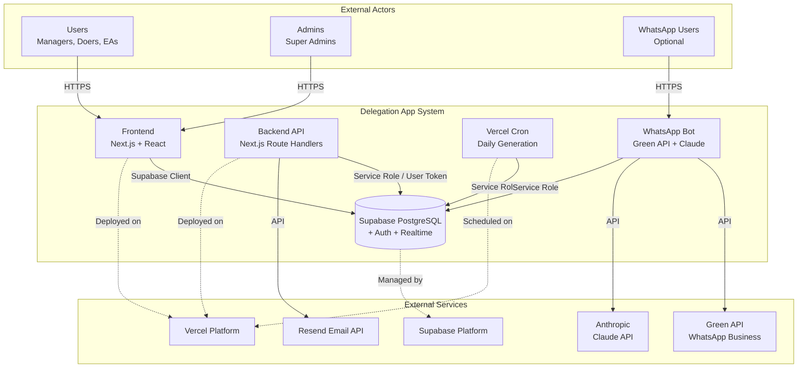

### 4.1 External Interfaces

| Interface | Protocol | Direction | Description |
|-----------|----------|-----------|-------------|
| Web Browser | HTTPS | Inbound | Primary user interface |
| Supabase Client | HTTPS/WSS | Outbound | Database, Auth, Realtime |
| Vercel Cron | HTTPS | Inbound (scheduled) | Daily checklist generation |
| Resend API | HTTPS | Outbound | Email delivery |
| Green API | HTTPS | Outbound/Inbound | WhatsApp messaging |
| Anthropic API | HTTPS | Outbound | AI for WhatsApp bot |

---

## 5. High-Level Architecture

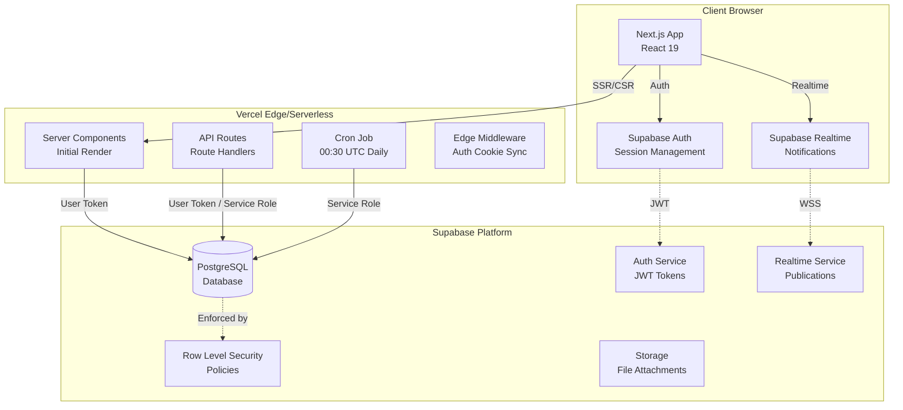

---

## 6. Component Architecture

### 6.1 Frontend Components (React)

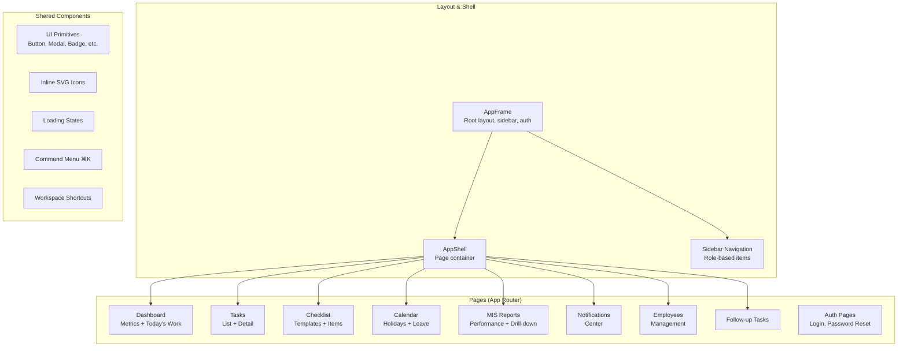

### 6.2 Backend Modules (lib/)

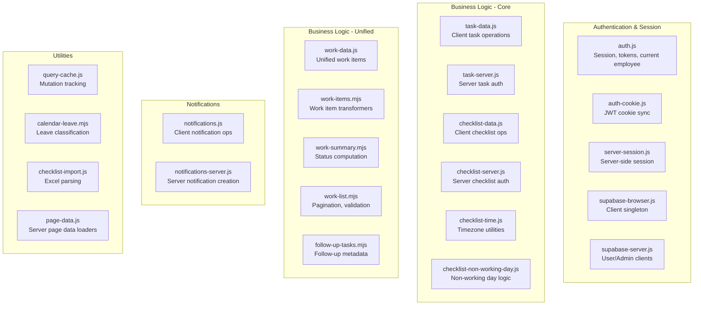

---

## 7. Frontend Architecture

### 7.1 Rendering Strategy

| Page Type | Strategy | Rationale |
|-----------|----------|-----------|
| **Dashboard, Tasks, Checklist, MIS, Calendar, Employees** | Server Component (initial) + Client hydration | Fast first paint, SEO, data freshness |
| **Login, Auth pages** | Server Component | No client state needed initially |
| **AppFrame, Sidebar, Command Menu** | Client Component | Interactive, stateful |
| **Notifications, Real-time updates** | Client Component + Supabase Realtime | Live updates |

### 7.2 State Management

| State Type | Mechanism | Scope |
|------------|-----------|-------|
| **Auth Session** | Supabase Auth + custom cookie sync | Global (AppFrame) |
| **Current Employee** | In-memory cache (30s TTL) + server prime | Global (AppFrame) |
| **Unread Notifications** | Realtime + polling fallback | Global (AppFrame) |
| **Page Data** | Server-rendered initial + client refresh | Per-page |
| **UI State (modals, forms)** | React useState/useReducer | Component-local |
| **Sidebar State** | localStorage + Context | Persistent |

### 7.3 Data Fetching Patterns

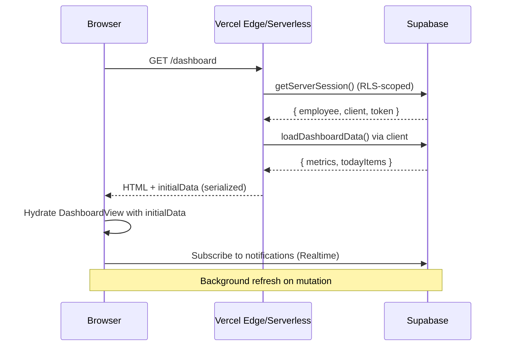

### 7.4 CSS Architecture

- **Design System**: CSS Custom Properties (variables) in `globals.css`
- **No external UI kit**: Custom components using Radix UI primitives
- **Color Tokens**: `--color-bg`, `--color-surface`, `--color-border`, `--color-text`, semantic colors
- **Component Classes**: `.button`, `.input`, `.panel`, `.modal`, `.badge`, `.task-row`, `.sidebar`
- **Layout**: `.app-shell` (CSS Grid), `.page-container`, `.detail-layout`

---

## 8. Backend Architecture

### 8.1 API Route Structure (Next.js Route Handlers)

```
/app/api/
├── account/
│   └── complete-password-change/     # First-time password change
├── admin/
│   └── employees/                    # Employee CRUD (super_admin)
├── checklist/
│   ├── templates/                    # Template CRUD
│   ├── generate/                     # Daily generation (Cron + manual)
│   ├── [id]/complete/                # Complete/reopen item
│   ├── import/                       # Excel import
│   ├── bulk-update/                  # Bulk edit templates
│   ├── bulk-delete/                  # Bulk delete templates
│   ├── non-working-days/             # Employee leave CRUD
│   ├── holidays/                     # National holidays CRUD
│   ├── deactivate-non-working-day/   # Preview/execute deactivation
│   └── proofs/cleanup/               # Proof screenshot cleanup (Cron)
├── tasks/
│   └── route.js                      # Task deletion
└── whatsapp/                         # WhatsApp bot webhook
```

### 8.2 Authorization Patterns

| Pattern | Implementation | Used By |
|---------|----------------|---------|
| **RLS-Only** | Direct Supabase client with user token | All read operations, client writes |
| **Server-Side Role Check** | `authorizeChecklistManager()` verifies role via `employees` table | Checklist API routes |
| **Service Role Admin** | `createSupabaseAdminClient()` bypasses RLS | Cron, employee management, deletions |
| **Dual Client** | User client for reads, admin client for writes | Employee creation/deletion |

### 8.3 Server-Side Data Loaders (`lib/page-data.js`)

| Loader | Purpose | Called By |
|--------|---------|-----------|
| `loadDashboardData()` | Metrics + today's work | `/dashboard` page |
| `loadTasksData()` | Paginated tasks + filters | `/tasks` page |
| `loadChecklistData()` | Templates + today's items | `/checklist` page |
| `loadMisData()` | MIS report + assignees | `/mis` page |
| `loadNotificationsPage()` | Paginated notifications | `/notifications` page |
| `loadFollowUpData()` | Follow-up work items | `/follow-up-tasks` page |
| `loadEmployeesData()` | Employee roster | `/employees` page |

---

## 9. Database Architecture

### 9.1 Database Technology

- **PostgreSQL** (via Supabase) — version managed by Supabase
- **Extensions**: `pgcrypto` (UUID generation, hashing)
- **Row Level Security**: Enabled on all tables
- **Realtime**: Publications on `notifications`, `tasks`, `checklist_items`, etc.

### 9.2 Schema Overview

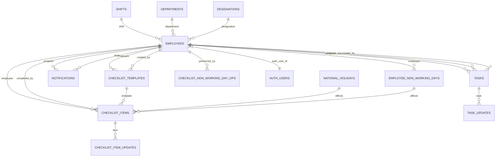

### 9.3 Key Tables

| Table | Purpose | RLS Policies |
|-------|---------|--------------|
| `employees` | Workspace roster linked to Supabase Auth | Managers read all; users read own; managers manage all |
| `tasks` | Ad-hoc delegated tasks | Managers read all; assignees/follower EAs read assigned; managers create; managers/assignees update |
| `task_updates` | Audit trail for tasks | Read if can read parent task; insert if author |
| `checklist_templates` | Recurring checklist definitions | Managers full CRUD; employees read own template via items |
| `checklist_items` | Generated checklist occurrences | Managers read all; employees read own; employees complete own |
| `checklist_item_updates` | Audit trail for checklist items | Similar to task_updates |
| `notifications` | In-app notification center | Recipient or manager read/update; only triggers insert |
| `national_holidays` | Country-specific holidays | All read; super_admin/ea manage |
| `employee_non_working_days` | Employee-specific leave dates | Managers read all; employees read own; managers manage |
| `checklist_non_working_day_operations` | Audit log for non-working day actions | Managers read |
| `shifts` | Work shift definitions | All authenticated read |
| `departments` | Department master | All authenticated read |
| `designations` | Designation master | All authenticated read |

### 9.4 Key Database Functions

| Function | Purpose |
|----------|---------|
| `current_employee()` | Returns employee row for current auth user |
| `is_manager()` | Returns true if current user has manager role |
| `guard_checklist_item_update()` | Prevents immutable field modification; enforces completion rules |
| `notify_task_events()` | Creates notifications on task insert/update |
| `notify_task_update_event()` | Creates notifications on task_updates insert |
| `notify_checklist_template_events()` | Creates notifications on template changes |
| `notify_checklist_item_events()` | Creates notifications on item creation/completion |
| `insert_notification_event()` | Idempotent notification insert with dedupe_key |
| `deactivate_checklist_items_for_non_working_day()` | RPC for bulk deactivation with audit |
| `get_work_report()` | RPC for MIS report aggregation |
| `save_employee_non_working_dates()` | Bulk save employee leave dates |
| `deactivate_sunday_checklist_items()` | Bulk deactivate Sunday items |

---

## 10. External Integrations

### 10.1 Supabase Platform

| Service | Usage |
|---------|-------|
| **Database** | Primary data store (PostgreSQL) |
| **Auth** | Email/password authentication, session management |
| **Realtime** | Live notifications via PostgreSQL publications |
| **Storage** | File attachments (proof screenshots) |

### 10.2 Vercel Platform

| Service | Usage |
|---------|-------|
| **Hosting** | Next.js application hosting |
| **Serverless Functions** | API routes execution |
| **Cron Jobs** | Daily checklist generation (00:30 UTC), proof cleanup (21:00 UTC) |
| **Edge Network** | Global CDN, middleware |

### 10.3 Resend (Email)

| Feature | Usage |
|---------|-------|
| **Transactional Email** | Employee invitations, password reset links |
| **Requirements** | Verified domain, API key, from email |

### 10.4 Green API + Anthropic (WhatsApp Bot - Optional)

| Component | Usage |
|-----------|-------|
| **Green API** | WhatsApp Business API (send/receive messages) |
| **Anthropic Claude** | AI-powered chat for task queries, reports |

---

## 11. Authentication and Authorization Architecture

### 11.1 Authentication Flow

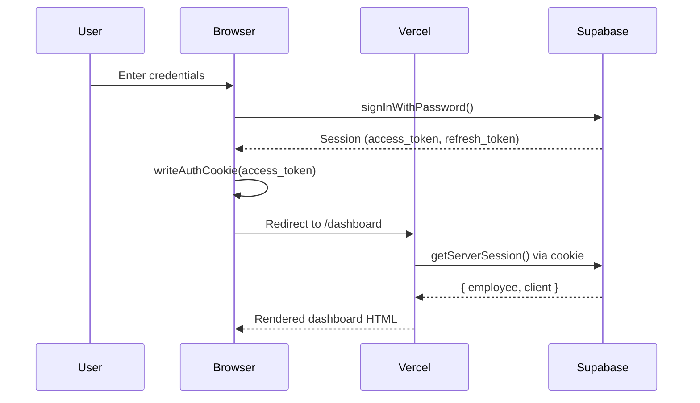

### 11.2 Session Management

| Aspect | Implementation |
|--------|----------------|
| **Token Storage** | HttpOnly cookie (`dl_access_token`) mirrored from Supabase session |
| **Auto-Refresh** | Supabase client `autoRefreshToken: true`; `getAccessToken()` forces refresh if <30s |
| **Server Access** | `getServerSession()` reads cookie, validates JWT, creates RLS-scoped client |
| **Client Access** | `supabaseBrowser()` singleton with `persistSession: true` |
| **Cache Invalidation** | `invalidateCurrentEmployee()` on role change, password change, sign-out |

### 11.3 Authorization Model (RBAC + RLS)

| Layer | Mechanism | Scope |
|-------|-----------|-------|
| **Database** | Row Level Security policies | All data access |
| **API Routes** | Server-side role verification (`authorizeChecklistManager`) | Write operations |
| **Frontend** | Role-based navigation, route guards | UI visibility |
| **Service Role** | Admin client bypassing RLS | Cron, admin operations |

### 11.4 Role Hierarchy

```
super_admin (highest)
    ├── Full workspace control
    ├── Employee management (including email change, password reset)
    ├── Last super_admin protection
    └── All manager permissions
assigner
    ├── Task/checklist creation
    ├── Employee management (create, edit, delete)
    ├── MIS access
    └── Cannot manage calendar
ea (Executive Assistant)
    ├── Task/checklist creation
    ├── Employee management
    ├── MIS access
    ├── Calendar management (holidays, leave)
    └── Checklist completion for any employee
doer (lowest)
    ├── View/complete assigned tasks
    ├── View/complete own checklist items
    └── No creation or management permissions
```

---

## 12. Data Flow

### 12.1 Task Creation Flow

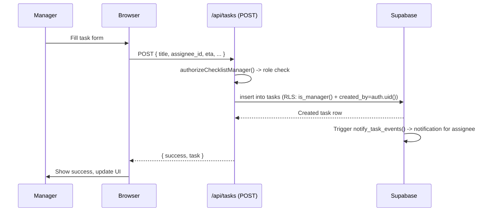

### 12.2 Checklist Generation Flow (Cron)

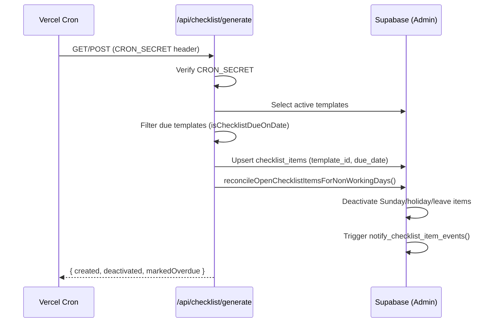

### 12.3 Checklist Completion Flow

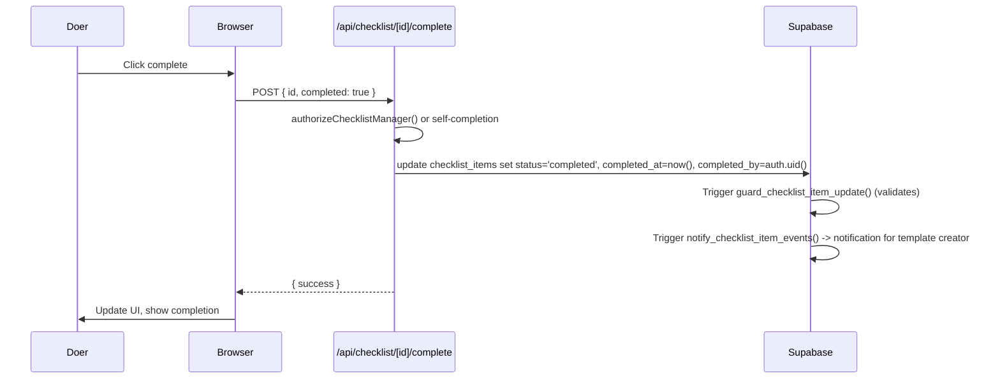

### 12.4 MIS Report Flow

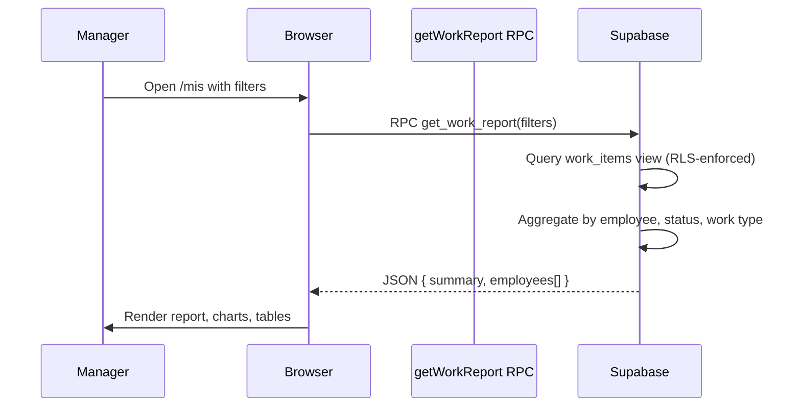

---

## 13. Communication Patterns

| Pattern | Implementation | Use Cases |
|---------|----------------|-----------|
| **Request/Response** | Next.js Route Handlers (REST-like) | All CRUD operations |
| **Server-Sent Events** | Supabase Realtime (WebSocket) | Live notifications |
| **Scheduled** | Vercel Cron → API Route | Daily checklist generation, proof cleanup |
| **Direct DB Access** | Supabase Client (browser/server) | Reads, RLS-enforced writes |
| **Async Background** | Database triggers → notifications | Audit trails, notifications |
| **Idempotent Writes** | `upsert` with `onConflict`, `dedupe_key` | Checklist generation, notifications |

---

## 14. Architecture Decisions and Trade-offs

### ADR-001: Direct Database Access vs. API Layer

| Decision | Use Supabase client directly from frontend (with RLS) instead of custom API layer for reads |
|----------|---------------------------------------------------------------------------------------------|
| **Context** | Need low-latency reads, real-time updates, reduced backend complexity |
| **Alternatives** | Traditional REST/GraphQL API layer; tRPC |
| **Consequences** | + Lower latency, native realtime, less code<br>+ RLS enforces security at data layer<br>- Tight coupling to Supabase<br>- Business logic in database (triggers, functions)<br>- Harder to swap database |

### ADR-002: Row Level Security as Primary Authorization

| Decision | All authorization enforced via PostgreSQL RLS policies |
|----------|--------------------------------------------------------|
| **Context** | Multi-tenant data isolation; need row-level permissions |
| **Alternatives** | Application-level authorization middleware; CASL/permissions library |
| **Consequences** | + Security at data layer (defense in depth)<br>+ Works for direct DB access<br>+ No authorization bypass possible<br>- Complex policy maintenance<br>- Debugging RLS failures can be difficult<br>- Limited to SQL-expressible rules |

### ADR-003: Unified Work Items View

| Decision | Create `work_items` view unifying tasks and checklist items for reporting |
|----------|--------------------------------------------------------------------------|
| **Context** | Dashboard, MIS, and notifications need combined view of work |
| **Alternatives** | Client-side merging; separate API endpoints |
| **Consequences** | + Single query for combined data<br>+ Consistent status computation<br>+ RLS enforced on underlying tables<br>- View complexity<br>- Materialized view not used (security_invoker) |

### ADR-004: Timezone Handling in Application Layer

| Decision | Store all timestamps as `timestamptz`; business logic in configured timezone (Asia/Kolkata) |
|----------|---------------------------------------------------------------------------------------------|
| **Context** | Checklist scheduling, due times, overdue computation |
| **Alternatives** | Store in UTC only; database timezone conversion |
| **Consequences** | + Consistent business date computation<br>+ Configurable via env var<br>+ No DST issues (Asia/Kolkata has no DST)<br>- Application must handle conversions<br>- Dual storage (due_date + due_at) |

### ADR-005: Idempotent Notification Delivery

| Decision | Use `dedupe_key` (SHA-256) with `ON CONFLICT DO NOTHING` for all notifications |
|----------|------------------------------------------------------------------------------|
| **Context** | Triggers may fire multiple times; realtime + Cron + manual triggers |
| **Alternatives** | Application-level deduplication; unique constraints without dedupe_key |
| **Consequences** | + Guaranteed no duplicates<br>+ Works across triggers and manual inserts<br>+ Notification delivery never rolls back business event<br>- Requires careful key design<br>- Storage overhead for keys |

### ADR-006: Server Components with Client Hydration

| Decision | Use Next.js Server Components for initial render; hydrate interactive parts |
|----------|---------------------------------------------------------------------------|
| **Context** | Need fast first paint, SEO, and interactivity |
| **Alternatives** | Full SPA (CSR); Full SSR |
| **Consequences** | + Fast TTFB, streaming<br>+ Reduced client bundle<br>+ Progressive enhancement<br>- Complexity in data fetching patterns<br>- Serialization boundaries |

### ADR-007: Custom CSS Design System vs. UI Library

| Decision | Build custom design system with CSS variables + Radix UI primitives |
|----------|---------------------------------------------------------------------|
| **Context** | Need unique branding, minimal bundle, full control |
| **Alternatives** | shadcn/ui, Tailwind UI, Material UI, Chakra UI |
| **Consequences** | + Zero runtime CSS-in-JS overhead<br>+ Full design control<br>+ Smaller bundle<br>- More maintenance effort<br>- No pre-built complex components |

---

## Document Control

| Version | Date | Author | Description |
|---------|------|--------|-------------|
| 1.0.0 | 2026-11-02 | Documentation Engineering Team | Initial version |

---

*End of Software Architecture Document*