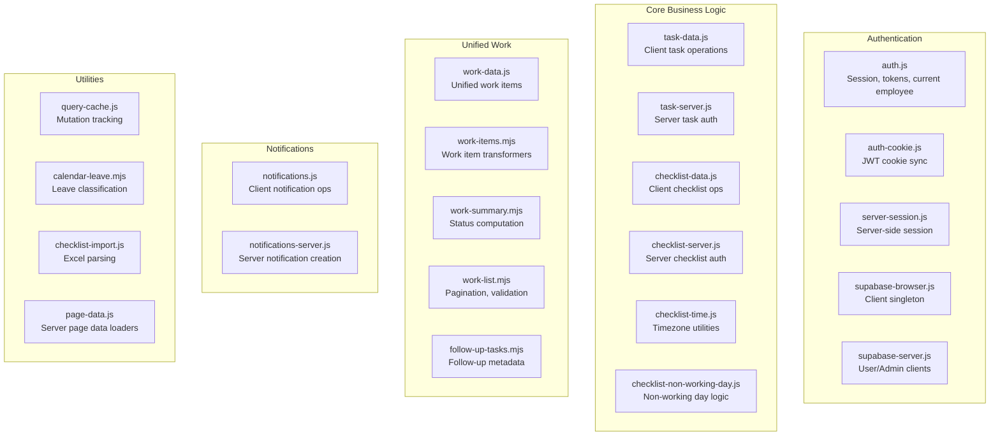

# Technical Design Document (TDD)

**Software/Project Name:** Delegation App
**Document ID:** DOC-TDD-001
**Version:** 1.0.0
**Status:** Draft
**Author:** Documentation Engineering Team
**Creation Date:** 2026-11-02
**Last Updated:** 2026-11-02

---

## Table of Contents

1. [Module Overview](#1-module-overview)
2. [Authentication Module](#2-authentication-module)
3. [Task Management Module](#3-task-management-module)
4. [Checklist Management Module](#4-checklist-management-module)
5. [Calendar & Non-Working Days Module](#5-calendar--non-working-days-module)
6. [Dashboard Module](#6-dashboard-module)
7. [MIS Reports Module](#7-mis-reports-module)
8. [Notifications Module](#8-notifications-module)
9. [Employee Management Module](#9-employee-management-module)
10. [WhatsApp Bot Module](#10-whatsapp-bot-module)
11. [Cross-Cutting Concerns](#11-cross-cutting-concerns)
12. [Data Validation](#12-data-validation)
13. [Error Handling](#13-error-handling)
14. [Security Implementation](#14-security-implementation)
15. [Performance Considerations](#15-performance-considerations)

---

## 1. Module Overview



---

## 2. Authentication Module

### 2.1 Responsibilities

- Session management (browser + server)
- Access token acquisition and refresh
- Current employee profile caching
- Role-based permission checks
- Authentication state synchronization

### 2.2 Key Components

#### `lib/auth.js` — Client-Side Auth State

| Function | Purpose |
|----------|---------|
| `getAuthenticatedUser()` | Returns Supabase auth user (from session) |
| `getCurrentEmployee()` | Returns `{ user, employee, error }` with 30s cache |
| `getAccessToken({ forceRefresh })` | Returns valid access token; refreshes if <30s expiry |
| `syncAuthSession(session)` | Updates cached session from auth state change |
| `clearAuthCache()` | Clears all auth caches on sign-out/password change |
| `invalidateCurrentEmployee()` | Forces employee profile refetch |
| `primeCurrentEmployee(employee, userId)` | Seeds cache from server-rendered data |
| `peekCurrentEmployee()` | Returns cached profile without fetching |
| `canCreateTasks(role)` | Checks if role can create tasks |

**Caching Strategy**: In-memory cache with 30s TTL; stale-while-revalidate pattern; cache invalidated on user change, sign-out, password change.

#### `lib/supabase-browser.js` — Browser Client Singleton

- Single `createClient()` instance with `persistSession: true`, `autoRefreshToken: true`
- `trackingFetch` wrapper marks mutations for query cache invalidation
- `onAuthStateChange` → `writeAuthCookie()` for server sync
- `supabaseRecoveryBrowser()` for PKCE password recovery flow

#### `lib/supabase-server.js` — Server Clients

| Function | Purpose |
|----------|---------|
| `createSupabaseUserClient(accessToken)` | RLS-scoped client for server components |
| `createSupabaseAdminClient()` | Service role client (bypasses RLS) |
| `getBearerToken(request)` | Extracts Bearer token from Authorization header |

#### `lib/server-session.js` — Server-Side Session

- `getServerSession()`: Reads `dl_access_token` cookie, validates JWT, creates RLS client, fetches employee + unread count
- Cached per request via React `cache()`
- Returns `{ client, token, userId, employee, unreadCount }` or `null`

#### `lib/auth-cookie.js` — Cookie Sync

- `writeAuthCookie(session)`: Mirrors Supabase access token to `dl_access_token` cookie
- `decodeJwtPayload(token)`: Parses JWT without verification (expiry check only)

### 2.3 Data Flow

```
Browser Sign-In → Supabase Auth → Session → writeAuthCookie() → dl_access_token cookie
                                    ↓
Server Request → getServerSession() → decode JWT → createSupabaseUserClient() → RLS client
                                    ↓
Server Component → loadDashboardData(client) → work_items view (RLS enforced)
```

### 2.4 Security Considerations

- Service role key **never** exposed to client (`NEXT_PUBLIC_SUPABASE_SERVICE_ROLE_KEY` forbidden)
- Access token in HttpOnly-equivalent cookie (SameSite=Lax, Secure in production)
- Token refresh automatic via Supabase client; forced refresh before API calls
- Cache invalidation on role change, password change, sign-out

---

## 3. Task Management Module

### 3.1 Responsibilities

- Task CRUD (create, read, update, delete)
- Task status transitions and validation
- Task updates/remarks with proof attachments
- Follow-up task metadata
- Employee assignment lists

### 3.2 Key Components

#### `lib/task-data.js` — Client Operations

| Function | Purpose |
|----------|---------|
| `getTasks({ limit, offset, select, assigneeId, priority, etaFrom, etaTo, nowIso, client })` | Filtered task list with pagination |
| `getTask(id, supabase)` | Single task detail with assignee, follower EA |
| `createTask(payload, client)` | Creates task (manager only) |
| `setTaskCompletion(id, completed, client)` | Completes/reopens task |
| `getTaskEmployees(client)` | All active employees for assignment |
| `getTaskAssignees(client)` | Employees eligible for task assignment |

#### `lib/task-server.js` — Server Authorization

| Function | Purpose |
|----------|---------|
| `authorizeTaskManager(request)` | Verifies manager role for task mutations |

#### `app/api/tasks/route.js` — API Endpoint

- `DELETE /api/tasks`: Soft delete (manager only)
  - Transfers assigned tasks, followed tasks, checklist templates, checklist items, audit records
  - Deletes Auth user if linked

### 3.3 Business Logic

#### Task Status Flow

```
pending → followup → delayed → submitted → closed
                    ↘ not_required
```

- Automatic overdue: `eta < now()` and not completed
- `completed_at` set on status = `closed`
- `original_eta` preserved for follow-up tracking

#### Follow-up Tasks

- Created when task marked `followup`
- Metadata: `followUpDate`, `originalScheduledDate`
- Appear in unified lists with special labeling
- Handled in `lib/follow-up-tasks.mjs`

### 3.4 Data Validation

- Title required, max 240 chars
- Assignee must be active employee
- ETA required, valid timestamptz
- Priority enum: `normal`, `high`, `critical`
- Status enum: `pending`, `followup`, `delayed`, `submitted`, `closed`, `not_required`
- Attachments: JSONB array of `{ url, name, type, size }`

---

## 4. Checklist Management Module

### 4.1 Responsibilities

- Checklist template CRUD
- Daily checklist item generation (Cron + manual)
- Checklist item completion/reopen
- Bulk operations (edit, delete)
- Excel import
- Non-working day handling

### 4.2 Key Components

#### `lib/checklist-data.js` — Client Operations

| Function | Purpose |
|----------|---------|
| `getChecklistTemplatesPage({ page, pageSize, search, employeeId, frequency, status, client })` | Paginated template list |
| `getChecklistItems({ employeeId, dueDate, dueDateFrom, dueDateTo, status, includeDeactivated, nowIso, client })` | Filtered checklist items |
| `setChecklistCompletion(id, completed, client)` | Complete/reopen via API |
| `triggerChecklistGeneration(client)` | Manual generation trigger |
| `getChecklistDashboardData({ now, client })` | Today's items + metrics |
| `formatChecklistDays(template)` | Human-readable frequency |
| `formatChecklistTime(time)` | Formatted due time |

#### `lib/checklist-server.js` — Server Authorization

| Function | Purpose |
|----------|---------|
| `authorizeChecklistManager(request)` | Verifies manager role (super_admin, assigner, ea) |
| `authorizeNonWorkingDayManager(request)` | Verifies super_admin or ea for calendar ops |

#### `lib/checklist-time.js` — Timezone Utilities

| Function | Purpose |
|----------|---------|
| `getChecklistBusinessDate(value, timeZone)` | Date in configured timezone |
| `localDateTimeToIso(dateValue, timeValue, timeZone)` | Local date+time → ISO timestamptz |
| `isChecklistDueOnDate(template, dateValue)` | Frequency matching logic |
| `formatChecklistDueAt(value, options)` | Display formatter |

#### `lib/checklist-non-working-day.js` — Non-Working Day Logic

| Function | Purpose |
|----------|---------|
| `reconcileOpenChecklistItemsForNonWorkingDays(admin, now)` | Generation-time reconciliation |
| `getNonWorkingDayPreview(admin, date)` | Preview deactivation for date |
| `deactivateNonWorkingDayItems(admin, preview, actor)` | Execute deactivation + notifications |
| `restoreChecklistItemsAfterEmployeeLeaveRemoval(admin, employeeId, date)` | Restore when leave removed |

#### API Routes

| Endpoint | Methods | Purpose |
|----------|---------|---------|
| `/api/checklist/templates` | GET, POST, PATCH, DELETE | Template CRUD |
| `/api/checklist/generate` | GET, POST | Daily generation (Cron + manual) |
| `/api/checklist/[id]/complete` | POST | Complete/reopen item |
| `/api/checklist/import` | POST | Excel import (preview + confirm) |
| `/api/checklist/bulk-update` | POST | Bulk edit selected templates |
| `/api/checklist/bulk-delete` | POST | Bulk delete selected templates |
| `/api/checklist/non-working-days` | GET, POST, DELETE | Employee leave CRUD |
| `/api/checklist/holidays` | GET, POST, PATCH, DELETE | National holiday CRUD |
| `/api/checklist/deactivate-non-working-day/preview` | GET | Preview deactivation |
| `/api/checklist/deactivate-non-working-day` | POST | Execute deactivation |

### 4.3 Business Logic

#### Template Frequencies

| Frequency | Schedule Parameters | Due Date Logic |
|-----------|---------------------|----------------|
| `daily` | None | Every business day |
| `weekly` | `weekday` (0-6) | Specific weekday |
| `every_15_days` | `start_date` | Every 15 days from start |
| `monthly` | `day_of_month` + `monthly_days[]` | Specific day(s) of month |

#### Generation Algorithm

```javascript
// Daily at 00:30 UTC (Asia/Kolkata business date)
const today = getChecklistBusinessDate(new Date(), 'Asia/Kolkata');
const dueTemplates = templates.filter(t => t.active && isChecklistDueOnDate(t, today));
const rows = dueTemplates.map(t => ({
  template_id: t.id,
  employee_id: t.employee_id,
  task: t.task,
  due_date: today,
  due_at: localDateTimeToIso(today, t.due_time, 'Asia/Kolkata'),
  status: isSunday(today) ? 'deactivated' : 'pending',
}));
// Upsert on (template_id, due_date) with ignoreDuplicates
```

#### Non-Working Day Classification

1. **Sundays**: `extract(dow from due_date) = 0`
2. **National Holidays**: `national_holidays.holiday_date = due_date AND country = 'India' AND is_active`
3. **Employee Leave**: `employee_non_working_days.employee_id = item.employee_id AND non_working_date = due_date AND reason = 'employee_leave'`

Items matching any → `status = 'deactivated'` (excluded from most views)

#### Reconciliation

Runs after every generation to catch:
- Items created before leave/holiday was added
- Items missed by previous runs
- Updates status: `pending`/`overdue` → `deactivated` or `pending` → `overdue`

### 4.4 Data Validation

- Template task: 1-240 chars
- Frequency enum + schedule constraint (enforced by DB)
- `due_time` required, default `17:00:00`
- `start_date` required
- `monthly_days` array: 1-31, max 31 elements
- Import: Excel with columns (Doer Name, Doer Email, Task Details, Task Type, ETA)

---

## 5. Calendar & Non-Working Days Module

### 5.1 Responsibilities

- National holiday CRUD (India default)
- Employee leave management
- Preview deactivation impact
- Execute deactivation with audit
- Automatic reconciliation

### 5.2 Key Components

#### `app/calendar/CalendarSettings.js` — UI Component

- Holiday management (add/edit/delete)
- Employee leave management (date picker, multi-select)
- Preview pane: shows items that would be deactivated
- Deactivate button: executes with confirmation

#### `lib/checklist-non-working-day.js` — Core Logic

(See Section 4.2 for function details)

#### Database Functions

| Function | Purpose |
|----------|---------|
| `deactivate_checklist_items_for_non_working_day(p_date, p_item_ids, p_performed_by, p_reason)` | RPC for bulk deactivation with audit log |
| `save_employee_non_working_dates(p_employee_id, p_dates, p_created_by)` | Bulk save leave dates |
| `deactivate_sunday_checklist_items()` | Bulk deactivate all Sunday items |

### 5.3 Audit Trail

`checklist_non_working_day_operations` table records:
- `selected_date`, `performed_by`, `matched_count`, `deactivated_count`, `reason`
- Linked to `checklist_item_updates` for individual item changes

---

## 6. Dashboard Module

### 6.1 Responsibilities

- Unified metrics (total, pending, overdue, completed)
- Today's work view (chronological)
- Role-aware data loading

### 6.2 Key Components

#### `lib/work-data.js` — Data Loaders

| Function | Purpose |
|----------|---------|
| `getUnifiedDashboardData({ now, signal, client })` | Metrics + today items |
| `getUnifiedWorkItems({ ... })` | Full unified list for export |
| `getWorkItemsPage({ ... })` | Paginated work_items view |
| `getWorkReport({ ... })` | MIS report via RPC |
| `sortTodaysWorkItems(items, now)` | Chronological sort (overdue → pending → completed) |
| `getWorkItemStatus(item, now)` | Unified status computation |

#### `lib/work-summary.mjs` — Status Computation

| Function | Purpose |
|----------|---------|
| `getUnifiedWorkItemStatus(workItem, now, explicitSource)` | Single status function |
| `getWorkSummary(workItems, now)` | Aggregate counts |
| `filterWorkItems(workItems, filters, now)` | In-memory filtering |

#### `app/dashboard/page.js` — Server Component

```javascript
export default async function DashboardPage() {
  const session = await getServerSession();
  const initial = session ? await loadDashboardData({ employee: session.employee, client: session.client }) : null;
  return <DashboardView initialData={withRenderTime(initial?.data || null)} />;
}
```

### 6.3 Data Flow

```
Server: getServerSession() → RLS client
       → loadDashboardData() → getUnifiedDashboardData()
            → getWorkReport() (RPC) + getWorkItemsPage(dueDate=today)
       → Serialize initialData → HTML
Client: DashboardView hydrates with initialData
       → Background refresh on mutation
```

---

## 7. MIS Reports Module

### 7.1 Responsibilities

- Employee-wise performance aggregation
- Status breakdowns with progress bars
- Work type mix (tasks vs checklist)
- Multi-dimensional filtering
- CSV export

### 7.2 Key Components

#### `get_work_report` RPC (Database)

```sql
CREATE OR REPLACE FUNCTION public.get_work_report(
  p_work_type text default 'all',
  p_status text default 'all',
  p_from date default null,
  p_to date default null,
  p_search text default null,
  p_priority text default 'all',
  p_employee_id uuid default null
) RETURNS jsonb
LANGUAGE SQL STABLE SECURITY INVOKER SET search_path = '' AS $$
  WITH filtered AS MATERIALIZED (
    SELECT work.*
    FROM public.work_items work
    WHERE (p_work_type = 'all' OR work.kind = p_work_type)
      AND (p_status = 'all' OR work.effective_status = p_status)
      AND (p_priority = 'all' OR work.priority = p_priority)
      AND (p_employee_id IS NULL OR work.employee_id = p_employee_id)
      AND (p_from IS NULL OR work.scheduled_date >= p_from)
      AND (p_to IS NULL OR work.scheduled_date <= p_to)
      AND (NULLIF(TRIM(p_search), '') IS NULL
           OR CONCAT_WS(' ', work.title, work.description, work.category, work.employee_name, work.employee_email)
             ILIKE '%' || TRIM(p_search) || '%')
  ), employee_rows AS (
    SELECT
      employee_id,
      MAX(employee_name) as employee_name,
      MAX(employee_email) as employee_email,
      COUNT(*)::int as total_work,
      COUNT(*) FILTER (WHERE effective_status = 'pending')::int as pending_work,
      COUNT(*) FILTER (WHERE effective_status = 'overdue')::int as overdue_work,
      COUNT(*) FILTER (WHERE effective_status = 'completed')::int as completed_work,
      COUNT(*) FILTER (WHERE kind = 'task')::int as tasks_work,
      COUNT(*) FILTER (WHERE kind = 'checklist')::int as checklist_work,
      COUNT(*) FILTER (
        WHERE effective_status = 'completed'
          AND completed_at IS NOT NULL
          AND scheduled_at IS NOT NULL
          AND completed_at <= scheduled_at
      )::int as on_time_work
    FROM filtered
    GROUP BY employee_id
  )
  SELECT jsonb_build_object(
    'summary', jsonb_build_object(
      'total', COUNT(*)::int,
      'pending', COUNT(*) FILTER (WHERE effective_status = 'pending')::int,
      'overdue', COUNT(*) FILTER (WHERE effective_status = 'overdue')::int,
      'completed', COUNT(*) FILTER (WHERE effective_status = 'completed')::int,
      'tasks', COUNT(*) FILTER (WHERE kind = 'task')::int,
      'checklist', COUNT(*) FILTER (WHERE kind = 'checklist')::int,
      'onTime', COUNT(*) FILTER (
        WHERE effective_status = 'completed'
          AND completed_at IS NOT NULL
          AND scheduled_at IS NOT NULL
          AND completed_at <= scheduled_at
      )::int
    ),
    'employees', COALESCE((
      SELECT jsonb_agg(
        jsonb_build_object(
          'employee_id', employee_id,
          'employee_name', employee_name,
          'employee_email', employee_email,
          'total_work', total_work,
          'pending_work', pending_work,
          'overdue_work', overdue_work,
          'completed_work', completed_work,
          'tasks_work', tasks_work,
          'checklist_work', checklist_work,
          'on_time_work', on_time_work,
          'on_time_percent', CASE WHEN completed_work = 0 THEN 0 ELSE ROUND(100.0 * on_time_work / completed_work)::int END
        ) ORDER BY employee_name, employee_id
      ) FROM employee_rows
    ), '[]'::jsonb)
  ) FROM filtered;
$$;
```

#### `lib/work-data.js` — Client Access

| Function | Purpose |
|----------|---------|
| `getWorkReport({ workType, status, priority, employeeId, from, to, search, signal, client })` | Calls RPC with validation |

#### `app/mis/MisView.js` — UI

- Filter panel (date range, employee, work type, status, priority, search)
- Summary cards + employee table with progress bars
- Drill-down: click row → paginated detail view
- Export: CSV download (overall or employee-specific)

### 7.3 Validation

`lib/work-list.mjs` — `validateWorkReportPayload()` validates RPC response structure.

---

## 8. Notifications Module

### 8.1 Responsibilities

- Real-time notification delivery
- Notification center UI
- Deduplication
- Mark read (individual/all)

### 8.2 Key Components

#### Database Triggers (Automatic)

| Trigger | Table | Event | Creates Notification For |
|---------|-------|-------|-------------------------|
| `notify_task_events` | tasks | INSERT, UPDATE | Assignee, follower EA, creator (on completion) |
| `notify_task_update_event` | task_updates | INSERT | Assignee (if not author) |
| `notify_checklist_template_events` | checklist_templates | INSERT, UPDATE | Employee, old/new assignee |
| `notify_checklist_item_events` | checklist_items | INSERT, UPDATE (status) | Employee, template creator/managers |
| `deactivate_checklist_items_for_non_working_day` | checklist_items | RPC | Affected employees |

#### `lib/notifications-server.js` — Server Creation

```javascript
export async function createServerNotifications(admin, records) {
  const rows = records.filter(r => r.recipient_employee_id && r.kind && r.title && r.dedupe_key);
  const { error } = await admin.from('notifications').upsert(rows, { 
    onConflict: 'dedupe_key', 
    ignoreDuplicates: true 
  });
  return { error };
}
```

#### `lib/notifications.js` — Client Operations

| Function | Purpose |
|----------|---------|
| `getUnreadNotificationCount(employeeId, { force })` | Cached count (2s TTL) |
| `markNotificationRead(id, employeeId)` | Single mark read |
| `markNotificationsRead(ids, employeeId)` | Bulk mark read |
| `markAllNotificationsRead(employeeId)` | Mark all read |
| `signalNotificationsChanged()` | Invalidates cache + dispatches event |

#### `app/notifications/NotificationsView.js` — UI

- Tabs: All / Unread / Read
- Pagination (30 per page)
- Real-time updates via Supabase Realtime subscription
- Click-through to source item

### 8.3 Deduplication Strategy

Every notification has `dedupe_key` (SHA-256 hash):

```
task_created: task_id:assignee_id
task_assignment_removed: task_id:old_assignee_id:change_hash
task_assignment_added: task_id:new_assignee_id:change_hash
task_updated: task_id:assignee_id:field_hash
task_completed: task_id:recipient_id:completed_at
checklist_item_created: item_id:employee_id
checklist_completed: item_id:recipient_id:completed_at
checklist_non_working_day_deactivated: date:employee_id
```

Insert: `ON CONFLICT (dedupe_key) DO NOTHING`

---

## 9. Employee Management Module

### 9.1 Responsibilities

- Employee roster management
- Auth user provisioning
- Role/active status updates
- Password reset
- Work transfer on deletion

### 9.2 Key Components

#### `app/api/admin/employees/route.js` — API

| Method | Purpose |
|--------|---------|
| `POST` | Create employee + Auth user + send invitation |
| `DELETE` | Delete employee (transfer work + delete Auth user) |
| `POST /update-email` | Update email (super_admin only) |
| `POST /reset-password` | Reset Auth password (super_admin) |

#### Creation Flow

```javascript
// 1. Generate secure random password
const initialPassword = randomBytes(32).toString('base64url');

// 2. Create Auth user (email_confirmed=true)
const { data: { user: authUser } } = await adminClient.auth.admin.createUser({
  email, password: initialPassword, email_confirm: true,
  user_metadata: { full_name: name }
});

// 3. Insert employees row (must_change_password=true)
const { data: employee } = await adminClient.from('employees').insert({
  auth_user_id: authUser.id, name, email, mobile, role, active: true, must_change_password: true
}).select().single();

// 4. Generate recovery link (not password reset!)
const { data: linkData } = await adminClient.auth.admin.generateLink({
  type: 'recovery', email, options: { redirectTo: `${appUrl}/update-password` }
});

// 5. Send invitation email via Resend
await sendCredentialEmail({ to: email, setupUrl: linkData.properties.action_link, ... });
```

#### Deletion Flow

```javascript
// 1. Verify not last super_admin
// 2. Transfer all work to requester:
//    - tasks.assignee_id, follower_ea_id
//    - checklist_templates.employee_id
//    - checklist_items.employee_id
//    - checklist_non_working_day_operations.performed_by
//    - tasks.created_by, task_updates.author_user_id
//    - checklist_templates.created_by, checklist_items.completed_by
//    - employee_leave_periods.created_by, employee_non_working_days.created_by
// 3. Delete employees row
// 4. Delete Auth user
```

### 9.3 Data Validation

- Name: required, max 120 chars
- Email: valid format, unique
- Role: enum (super_admin, assigner, ea, doer)
- Mobile: optional, max 40 chars
- Active: boolean

---

## 10. WhatsApp Bot Module (Optional)

### 10.1 Responsibilities

- WhatsApp message receive/send via Green API
- AI-powered responses via Anthropic Claude
- Task alerts to EA/directors
- Daily summary reports
- Person report command

### 10.2 Key Components

#### `app/api/whatsapp/route.js` — Webhook

- Receives inbound messages from Green API
- Validates webhook token
- Processes commands via AI agent

#### `lib/server/whatsapp-*.mjs` — Bot Logic

| Module | Purpose |
|--------|---------|
| `whatsapp-bot.mjs` | Main bot orchestration |
| `whatsapp-commands.mjs` | Command parsing |
| `whatsapp-execute.mjs` | Command execution |
| `whatsapp-alerts.mjs` | Task alert delivery |
| `whatsapp-daily-report.mjs` | 6 PM summary generation |
| `whatsapp-person-report.mjs` | Individual performance report |
| `whatsapp-format.mjs` | Message formatting |
| `whatsapp-dates.mjs` | Date parsing for commands |
| `whatsapp-permissions.mjs` | Authorization checks |
| `whatsapp-updates.mjs` | Update notifications |

### 10.3 Database (Migration 20261026120000 + patches)

| Table | Purpose |
|-------|---------|
| `whatsapp_chat_links` | Maps WhatsApp chat IDs to employee IDs |
| `whatsapp_bot_state` | Conversation state per chat |

---

## 11. Cross-Cutting Concerns

### 11.1 Query Cache Invalidation (`lib/query-cache.js`)

- `markMutation()`: Increments global mutation counter
- `getLastMutationAt()`: Returns timestamp of last mutation
- `withRenderTime(data)`: Adds `renderedAt` timestamp
- `isFreshRender(initialData)`: Checks if server render is fresh (<10s, no mutations)

### 11.2 Work Item Transformers (`lib/work-items.mjs`)

| Function | Purpose |
|----------|---------|
| `toTaskWorkItem(task)` | Normalizes task to work item |
| `toChecklistWorkItem(item)` | Normalizes checklist item to work item |
| `normalizeWorkItem(item)` | Dispatches to appropriate transformer |
| `dedupeWorkItems(items)` | Removes duplicates by `kind:id` |
| `compareWorkItemsChronologically(a, b, now)` | Sort comparator |
| `sortWorkItemsChronologically(items, now)` | Sorts array |
| `getWorkItemDueDateTime(item)` | Extracts due date/time for sorting |
| `addFollowUpMetadata(item, holidayDates, timeZone)` | Adds follow-up fields |

### 11.3 Pagination & Validation (`lib/work-list.mjs`)

| Function | Purpose |
|----------|---------|
| `normalizeWorkListRequest(input)` | Normalizes filters, pagination |
| `validateWorkReportPayload(data)` | Validates MIS RPC response |
| `WORK_PAGE_SIZE` | Default page size (50) |
| `getWorkQueryError(error)` | Normalizes Supabase errors |

### 11.4 Timezone Handling (`lib/checklist-time.js`)

- Default: `Asia/Kolkata` (configurable via `CHECKLIST_TIMEZONE`)
- All due times stored as `timestamptz` (`due_at`)
- Business date computed in configured timezone
- `Intl.DateTimeFormat` for reliable timezone conversion

---

## 12. Data Validation

### 12.1 Client-Side (Zod Schemas)

- Checklist template create/update
- Task create
- Employee create/update
- Excel import preview

### 12.2 Server-Side (API Route Validation)

```javascript
// Example: Employee creation validation
function validatePayload(payload) {
  const name = payload?.name?.trim();
  const email = payload?.email?.trim().toLowerCase();
  const role = payload?.role;
  // ... validation rules
  if (!name) return { error: 'Full name is required.' };
  if (!emailPattern.test(email)) return { error: 'A valid work email is required.' };
  // ...
}
```

### 12.3 Database Constraints

- Enum types: `app_role`, `task_status`, `task_priority`, `checklist_freq`
- Check constraints: schedule fields, completion fields, date ranges
- Unique constraints: `employees.auth_user_id`, `checklist_items(template_id, due_date)`
- Foreign keys with `ON DELETE` rules (RESTRICT, SET NULL, CASCADE)

---

## 13. Error Handling

### 13.1 API Error Responses

```javascript
function errorResponse(message, status) {
  return Response.json({ error: message }, { status });
}

function checklistApiError(message, status) {
  return Response.json({ success: false, error: message }, { status });
}
```

### 13.2 Database Error Mapping

| Error Pattern | User Message |
|---------------|--------------|
| `PGRST116` (no rows) | Not found |
| `23505` (unique violation) | Already exists |
| `23503` (FK violation) | Referenced record missing |
| `42501` (RLS violation) | Permission denied |
| Migration missing (`column does not exist`) | Specific migration required |

### 13.3 Client Error Handling

- Try/catch in async functions
- Toast notifications for user-facing errors
- Console logging with error codes for debugging
- Graceful degradation (e.g., notification count failure doesn't block UI)

---

## 14. Security Implementation

### 14.1 Authentication

- Supabase Auth (email/password)
- JWT in `dl_access_token` cookie (SameSite=Lax, Secure)
- Auto-refresh via Supabase client
- PKCE flow for password recovery

### 14.2 Authorization

- RLS on all tables (ADR-002)
- Server-side role checks for mutations
- Service role only for Cron/admin
- No `NEXT_PUBLIC_SUPABASE_SERVICE_ROLE_KEY`

### 14.3 Data Protection

- HTTPS only (Vercel default)
- CSP headers via Next.js
- No sensitive data in client logs
- Proof screenshots in Supabase Storage (private)

### 14.4 Secrets Management

- All secrets in Vercel Environment Variables
- Separate values for Production/Preview/Development
- `CRON_SECRET` for Vercel Cron authentication
- Rotation procedure documented

---

## 15. Performance Considerations

### 15.1 Database

- Partial indexes on hot paths (`tasks_open_eta_id_idx`, `checklist_items_open_due_at_id_idx`)
- `security_invoker` view for RLS without performance penalty
- RPC for MIS aggregation (server-side)
- Materialized CTE in `get_work_report` for filter reuse

### 15.2 Frontend

- Server Components for initial render
- Stale-while-revalidate (30s employee cache, 2s notification count)
- Background refresh on mutation detection
- Dynamic imports for heavy components (CommandMenu, DashboardTodayWork)
- Pagination (50 items default, 20 for task sections)

### 15.3 Caching

- Vercel Edge caching for static assets
- `experimental.staleTimes` in Next.js config (dynamic: 30s, static: 60s)
- Query cache invalidation via mutation counter
- Realtime subscriptions for live updates

### 15.4 Monitoring

- Query duration logging (>1500ms or non-production)
- MIS report duration + filter diagnostics
- Error logging with codes and context
- Vercel Analytics + Supabase Dashboard

---

## Document Control

| Version | Date | Author | Description |
|---------|------|--------|-------------|
| 1.0.0 | 2026-11-02 | Documentation Engineering Team | Initial version |

---

*End of Technical Design Document*