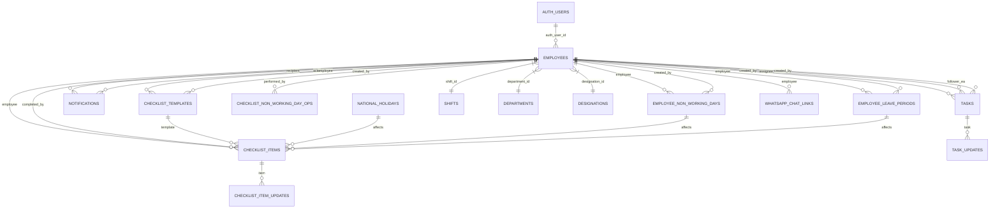

# Database Design Document

**Software/Project Name:** Delegation App
**Document ID:** DOC-DB-001
**Version:** 1.0.0
**Status:** Draft
**Author:** Documentation Engineering Team
**Creation Date:** 2026-11-02
**Last Updated:** 2026-11-02

---

## Table of Contents

1. [Database Technology](#1-database-technology)
2. [Entity Relationship Diagram](#2-entity-relationship-diagram)
3. [Tables and Descriptions](#3-tables-and-descriptions)
4. [Column Definitions and Data Types](#4-column-definitions-and-data-types)
5. [Primary and Foreign Keys](#5-primary-and-foreign-keys)
6. [Relationships](#6-relationships)
7. [Indexes](#7-indexes)
8. [Constraints](#8-constraints)
9. [Views](#9-views)
10. [Functions and Triggers](#10-functions-and-triggers)
11. [Row Level Security Policies](#11-row-level-security-policies)
12. [Migration Strategy](#12-migration-strategy)
13. [Data Retention and Backup](#13-data-retention-and-backup)

---

## 1. Database Technology

| Attribute | Value |
|-----------|-------|
| **Database** | PostgreSQL (via Supabase) |
| **Version** | Managed by Supabase (currently PostgreSQL 15+) |
| **Extensions** | `pgcrypto` (UUID generation, hashing) |
| **Connection Pooling** | Supabase PgBouncer (transaction mode) |
| **Realtime** | PostgreSQL Publications + Supabase Realtime |
| **Backups** | Supabase automated (daily, point-in-time recovery) |
| **Region** | Singapore (ap-southeast-1) — same as Vercel syd1 |

---

## 2. Entity Relationship Diagram



### Table Groups

| Group | Tables | Purpose |
|-------|--------|---------|
| **Core** | `employees`, `shifts`, `departments`, `designations` | Workspace roster and org structure |
| **Tasks** | `tasks`, `task_updates` | Ad-hoc task delegation |
| **Checklists** | `checklist_templates`, `checklist_items`, `checklist_item_updates` | Recurring work |
| **Notifications** | `notifications` | In-app notification center |
| **Calendar** | `national_holidays`, `employee_non_working_days`, `employee_leave_periods`, `checklist_non_working_day_operations` | Non-working day management |
| **WhatsApp** | `whatsapp_chat_links`, `whatsapp_bot_state` | Optional bot integration |
| **Views** | `work_items`, `checklist_template_list`, `employee_mis`, `follow_up_work_items` | Unified read models |

---

## 3. Tables and Descriptions

### 3.1 Core Tables

| Table | Description | Row Count Estimate |
|-------|-------------|-------------------|
| `employees` | Workspace roster linked to Supabase Auth | 10-500 |
| `shifts` | Work shift definitions (days, times) | 5-20 |
| `departments` | Department master | 5-50 |
| `designations` | Designation/title master | 10-100 |

### 3.2 Task Tables

| Table | Description | Row Count Estimate |
|-------|-------------|-------------------|
| `tasks` | Ad-hoc delegated tasks | 1,000-100,000 |
| `task_updates` | Audit trail for tasks | 5,000-500,000 |

### 3.3 Checklist Tables

| Table | Description | Row Count Estimate |
|-------|-------------|-------------------|
| `checklist_templates` | Recurring checklist definitions | 100-5,000 |
| `checklist_items` | Generated checklist occurrences | 10,000-1,000,000 |
| `checklist_item_updates` | Audit trail for checklist items | 5,000-500,000 |

### 3.4 Notification & Calendar Tables

| Table | Description | Row Count Estimate |
|-------|-------------|-------------------|
| `notifications` | In-app notification center | 10,000-1,000,000 |
| `national_holidays` | Country-specific holidays | 20-100 |
| `employee_non_working_days` | Employee-specific leave dates | 100-10,000 |
| `employee_leave_periods` | Legacy leave periods (date ranges) | 100-10,000 |
| `checklist_non_working_day_operations` | Audit log for non-working day actions | 100-10,000 |

### 3.5 WhatsApp Tables (Optional)

| Table | Description | Row Count Estimate |
|-------|-------------|-------------------|
| `whatsapp_chat_links` | Maps WhatsApp chats to employees | 10-500 |
| `whatsapp_bot_state` | Conversation state per chat | 10-500 |

---

## 4. Column Definitions and Data Types

### 4.1 `employees`

| Column | Type | Constraints | Description |
|--------|------|-------------|-------------|
| `id` | `uuid` | PK, `gen_random_uuid()` | Primary key |
| `auth_user_id` | `uuid` | UNIQUE, FK → `auth.users(id)` ON DELETE SET NULL | Supabase Auth linkage |
| `name` | `text` | NOT NULL | Full name |
| `email` | `text` | | Work email |
| `mobile` | `text` | | Personal mobile |
| `company_mobile` | `text` | | Company mobile |
| `role` | `app_role` | NOT NULL DEFAULT `'doer'` | Role enum |
| `department_id` | `uuid` | FK → `departments(id)` | Department |
| `designation_id` | `uuid` | FK → `designations(id)` | Designation |
| `shift_id` | `uuid` | FK → `shifts(id)` | Work shift |
| `active` | `boolean` | NOT NULL DEFAULT `true` | Workspace access |
| `must_change_password` | `boolean` | NOT NULL DEFAULT `true` | First login flag |
| `created_at` | `timestamptz` | DEFAULT `now()` | Creation timestamp |

### 4.2 `tasks`

| Column | Type | Constraints | Description |
|--------|------|-------------|-------------|
| `id` | `uuid` | PK, `gen_random_uuid()` | Primary key |
| `title` | `text` | NOT NULL | Task title |
| `description` | `text` | | Task description |
| `priority` | `task_priority` | NOT NULL DEFAULT `'normal'` | Priority enum |
| `status` | `task_status` | NOT NULL DEFAULT `'pending'` | Status enum |
| `created_by` | `uuid` | NOT NULL, FK → `auth.users(id)` | Creator auth user |
| `assignee_id` | `uuid` | NOT NULL, FK → `employees(id)` | Assigned employee |
| `follower_ea_id` | `uuid` | FK → `employees(id)` | Follower EA |
| `eta` | `timestamptz` | NOT NULL | Due date/time |
| `original_eta` | `timestamptz` | | Original ETA for follow-ups |
| `eta_revised` | `boolean` | NOT NULL DEFAULT `false` | ETA changed flag |
| `proof_required` | `boolean` | NOT NULL DEFAULT `true` | Proof required |
| `proof_note` | `text` | | Proof instructions |
| `submitted_at` | `timestamptz` | | Submission timestamp |
| `completed_at` | `timestamptz` | | Completion timestamp |
| `cancel_reason` | `text` | | Cancellation reason |
| `category` | `text` | NOT NULL DEFAULT `'General'` | Category |
| `start_date` | `timestamptz` | | Start date |
| `instructions` | `text` | | Special instructions |
| `completion_notes` | `text` | | Completion notes |
| `attachments` | `jsonb` | NOT NULL DEFAULT `'[]'` | Proof attachments |
| `created_at` | `timestamptz` | DEFAULT `now()` | Creation timestamp |
| `updated_at` | `timestamptz` | DEFAULT `now()` | Last update timestamp |

### 4.3 `task_updates`

| Column | Type | Constraints | Description |
|--------|------|-------------|-------------|
| `id` | `uuid` | PK, `gen_random_uuid()` | Primary key |
| `task_id` | `uuid` | NOT NULL, FK → `tasks(id)` ON DELETE CASCADE | Parent task |
| `author_user_id` | `uuid` | NOT NULL, FK → `auth.users(id)` | Author auth user |
| `update_type` | `text` | NOT NULL DEFAULT `'remark'` | Update type |
| `remark` | `text` | | Update content |
| `new_eta` | `timestamptz` | | Revised ETA |
| `proof_url` | `text` | | Proof attachment URL |
| `created_at` | `timestamptz` | DEFAULT `now()` | Creation timestamp |

### 4.4 `checklist_templates`

| Column | Type | Constraints | Description |
|--------|------|-------------|-------------|
| `id` | `uuid` | PK, `gen_random_uuid()` | Primary key |
| `employee_id` | `uuid` | NOT NULL, FK → `employees(id)` ON DELETE RESTRICT | Assigned employee |
| `task` | `text` | NOT NULL, CHECK length 1-240 | Task description |
| `frequency` | `text` | NOT NULL, CHECK IN ('daily','weekly','every_15_days','monthly') | Frequency |
| `weekday` | `smallint` | CHECK BETWEEN 0 AND 6 | Weekday (0=Sun) |
| `day_of_month` | `smallint` | CHECK BETWEEN 1 AND 31 | Day of month |
| `monthly_days` | `smallint[]` | NOT NULL DEFAULT `'{}'` | Multiple monthly days |
| `start_date` | `date` | NOT NULL | Generation start date |
| `due_time` | `time` | NOT NULL DEFAULT `'17:00:00'` | Due time of day |
| `active` | `boolean` | NOT NULL DEFAULT `true` | Template active |
| `created_by` | `uuid` | FK → `auth.users(id)` ON DELETE SET NULL | Creator auth user |
| `created_at` | `timestamptz` | DEFAULT `now()` | Creation timestamp |
| `updated_at` | `timestamptz` | DEFAULT `now()` | Last update timestamp |

### 4.5 `checklist_items`

| Column | Type | Constraints | Description |
|--------|------|-------------|-------------|
| `id` | `uuid` | PK, `gen_random_uuid()` | Primary key |
| `template_id` | `uuid` | NOT NULL, FK → `checklist_templates(id)` ON DELETE RESTRICT | Source template |
| `employee_id` | `uuid` | NOT NULL, FK → `employees(id)` ON DELETE RESTRICT | Assigned employee |
| `task` | `text` | NOT NULL, CHECK length 1-240 | Task description |
| `due_date` | `date` | NOT NULL | Due date |
| `due_at` | `timestamptz` | NOT NULL | Due date/time (timezone-aware) |
| `status` | `text` | NOT NULL DEFAULT `'pending'`, CHECK IN ('pending','completed','overdue','deactivated') | Status |
| `completed_at` | `timestamptz` | | Completion timestamp |
| `completed_by` | `uuid` | FK → `auth.users(id)` ON DELETE SET NULL | Completer auth user |
| `created_at` | `timestamptz` | DEFAULT `now()` | Creation timestamp |

### 4.6 `checklist_item_updates`

| Column | Type | Constraints | Description |
|--------|------|-------------|-------------|
| `id` | `uuid` | PK, `gen_random_uuid()` | Primary key |
| `checklist_item_id` | `uuid` | NOT NULL, FK → `checklist_items(id)` ON DELETE CASCADE | Parent item |
| `author_user_id` | `uuid` | NOT NULL, FK → `auth.users(id)` | Author auth user |
| `update_type` | `text` | NOT NULL DEFAULT `'remark'` | Update type |
| `remark` | `text` | | Update content |
| `proof_url` | `text` | | Proof attachment URL |
| `created_at` | `timestamptz` | DEFAULT `now()` | Creation timestamp |

### 4.7 `notifications`

| Column | Type | Constraints | Description |
|--------|------|-------------|-------------|
| `id` | `uuid` | PK, `gen_random_uuid()` | Primary key |
| `recipient_employee_id` | `uuid` | NOT NULL, FK → `employees(id)` ON DELETE CASCADE | Recipient |
| `actor_employee_id` | `uuid` | FK → `employees(id)` ON DELETE SET NULL | Actor |
| `task_id` | `uuid` | FK → `tasks(id)` ON DELETE CASCADE | Related task |
| `kind` | `text` | NOT NULL | Notification type |
| `title` | `text` | NOT NULL | Display title |
| `body` | `text` | | Detail text |
| `entity_type` | `text` | | Entity type (task, checklist_item, etc.) |
| `entity_id` | `uuid` | | Entity ID |
| `dedupe_key` | `text` | UNIQUE | Deduplication hash |
| `read_at` | `timestamptz` | | Read timestamp |
| `created_at` | `timestamptz` | DEFAULT `now()` | Creation timestamp |

### 4.8 `national_holidays`

| Column | Type | Constraints | Description |
|--------|------|-------------|-------------|
| `id` | `uuid` | PK, `gen_random_uuid()` | Primary key |
| `holiday_date` | `date` | NOT NULL | Holiday date |
| `name` | `text` | NOT NULL, CHECK length 1-160 | Holiday name |
| `country` | `text` | NOT NULL DEFAULT `'India'`, CHECK length 2-80 | Country |
| `is_active` | `boolean` | NOT NULL DEFAULT `true` | Active flag |
| `created_at` | `timestamptz` | DEFAULT `now()` | Creation timestamp |
| `updated_at` | `timestamptz` | DEFAULT `now()` | Last update timestamp |
| **Unique** | | `(holiday_date, country)` | One per date per country |

### 4.9 `employee_non_working_days`

| Column | Type | Constraints | Description |
|--------|------|-------------|-------------|
| `id` | `uuid` | PK, `gen_random_uuid()` | Primary key |
| `employee_id` | `uuid` | NOT NULL, FK → `employees(id)` ON DELETE CASCADE | Employee |
| `non_working_date` | `date` | NOT NULL | Non-working date |
| `reason` | `text` | NOT NULL DEFAULT `'employee_leave'`, CHECK = `'employee_leave'` | Reason |
| `created_at` | `timestamptz` | DEFAULT `now()` | Creation timestamp |
| `updated_at` | `timestamptz` | DEFAULT `now()` | Last update timestamp |
| `created_by` | `uuid` | FK → `auth.users(id)` ON DELETE SET NULL | Creator |
| **Unique** | | `(employee_id, non_working_date, reason)` | One per employee per date |

### 4.10 `employee_leave_periods` (Legacy)

| Column | Type | Constraints | Description |
|--------|------|-------------|-------------|
| `id` | `uuid` | PK, `gen_random_uuid()` | Primary key |
| `employee_id` | `uuid` | NOT NULL, FK → `employees(id)` ON DELETE CASCADE | Employee |
| `start_date` | `date` | NOT NULL | Leave start |
| `end_date` | `date` | NOT NULL | Leave end |
| `status` | `text` | DEFAULT `'approved'`, CHECK IN ('pending','approved','rejected','cancelled') | Status |
| `reason` | `text` | | Leave reason |
| `created_by` | `uuid` | FK → `auth.users(id)` ON DELETE SET NULL | Creator |
| `created_at` | `timestamptz` | DEFAULT `now()` | Creation timestamp |
| `updated_at` | `timestamptz` | DEFAULT `now()` | Last update timestamp |
| **Check** | | `end_date >= start_date` | Valid range |

### 4.11 `checklist_non_working_day_operations`

| Column | Type | Constraints | Description |
|--------|------|-------------|-------------|
| `id` | `uuid` | PK, `gen_random_uuid()` | Primary key |
| `selected_date` | `date` | NOT NULL | Operation date |
| `performed_by` | `uuid` | NOT NULL, FK → `employees(id)` ON DELETE RESTRICT | Performer |
| `matched_count` | `integer` | NOT NULL DEFAULT `0`, CHECK >= 0 | Items matched |
| `deactivated_count` | `integer` | NOT NULL DEFAULT `0`, CHECK >= 0 | Items deactivated |
| `reason` | `text` | NOT NULL | Operation reason |
| `created_at` | `timestamptz` | DEFAULT `now()` | Creation timestamp |

### 4.12 `shifts`

| Column | Type | Constraints | Description |
|--------|------|-------------|-------------|
| `id` | `uuid` | PK, `gen_random_uuid()` | Primary key |
| `name` | `text` | NOT NULL | Shift name |
| `work_days` | `int[]` | NOT NULL DEFAULT `'{1,2,3,4,5,6}'` | Working days (1=Mon) |
| `start_time` | `time` | NOT NULL DEFAULT `'09:30'` | Shift start |
| `end_time` | `time` | NOT NULL DEFAULT `'18:30'` | Shift end |
| `active` | `boolean` | NOT NULL DEFAULT `true` | Active flag |
| `created_at` | `timestamptz` | DEFAULT `now()` | Creation timestamp |

### 4.13 `departments`

| Column | Type | Constraints | Description |
|--------|------|-------------|-------------|
| `id` | `uuid` | PK, `gen_random_uuid()` | Primary key |
| `name` | `text` | UNIQUE NOT NULL | Department name |
| `active` | `boolean` | DEFAULT `true` | Active flag |

### 4.14 `designations`

| Column | Type | Constraints | Description |
|--------|------|-------------|-------------|
| `id` | `uuid` | PK, `gen_random_uuid()` | Primary key |
| `name` | `text` | UNIQUE NOT NULL | Designation name |
| `active` | `boolean` | DEFAULT `true` | Active flag |

### 4.15 WhatsApp Tables

| Table | Columns |
|-------|---------|
| `whatsapp_chat_links` | `id` (PK), `employee_id` (FK), `chat_id` (text), `phone_number` (text), `created_at`, `updated_at`, UNIQUE(`chat_id`) |
| `whatsapp_bot_state` | `id` (PK), `chat_id` (text), `state` (jsonb), `updated_at` |

---

## 5. Primary and Foreign Keys

### 5.1 Primary Keys

All tables use `uuid` with `gen_random_uuid()` as primary key.

### 5.2 Foreign Keys

| Child Table | Column | Parent Table | Parent Column | On Delete |
|-------------|--------|--------------|---------------|-----------|
| `employees` | `auth_user_id` | `auth.users` | `id` | SET NULL |
| `employees` | `department_id` | `departments` | `id` | SET NULL |
| `employees` | `designation_id` | `designations` | `id` | SET NULL |
| `employees` | `shift_id` | `shifts` | `id` | SET NULL |
| `tasks` | `created_by` | `auth.users` | `id` | RESTRICT |
| `tasks` | `assignee_id` | `employees` | `id` | RESTRICT |
| `tasks` | `follower_ea_id` | `employees` | `id` | SET NULL |
| `task_updates` | `task_id` | `tasks` | `id` | CASCADE |
| `task_updates` | `author_user_id` | `auth.users` | `id` | RESTRICT |
| `checklist_templates` | `employee_id` | `employees` | `id` | RESTRICT |
| `checklist_templates` | `created_by` | `auth.users` | `id` | SET NULL |
| `checklist_items` | `template_id` | `checklist_templates` | `id` | RESTRICT |
| `checklist_items` | `employee_id` | `employees` | `id` | RESTRICT |
| `checklist_items` | `completed_by` | `auth.users` | `id` | SET NULL |
| `checklist_item_updates` | `checklist_item_id` | `checklist_items` | `id` | CASCADE |
| `checklist_item_updates` | `author_user_id` | `auth.users` | `id` | RESTRICT |
| `notifications` | `recipient_employee_id` | `employees` | `id` | CASCADE |
| `notifications` | `actor_employee_id` | `employees` | `id` | SET NULL |
| `notifications` | `task_id` | `tasks` | `id` | CASCADE |
| `employee_non_working_days` | `employee_id` | `employees` | `id` | CASCADE |
| `employee_non_working_days` | `created_by` | `auth.users` | `id` | SET NULL |
| `employee_leave_periods` | `employee_id` | `employees` | `id` | CASCADE |
| `employee_leave_periods` | `created_by` | `auth.users` | `id` | SET NULL |
| `checklist_non_working_day_operations` | `performed_by` | `employees` | `id` | RESTRICT |
| `whatsapp_chat_links` | `employee_id` | `employees` | `id` | CASCADE |

---

## 6. Relationships

### 6.1 One-to-Many

- `employees` → `tasks` (as assignee)
- `employees` → `tasks` (as follower EA)
- `employees` → `tasks` (as creator)
- `employees` → `checklist_templates` (as assignee)
- `employees` → `checklist_templates` (as creator)
- `employees` → `checklist_items` (as assignee)
- `employees` → `checklist_items` (as completer)
- `employees` → `notifications` (as recipient)
- `employees` → `notifications` (as actor)
- `employees` → `employee_non_working_days`
- `employees` → `employee_leave_periods`
- `employees` → `checklist_non_working_day_operations`
- `tasks` → `task_updates`
- `checklist_templates` → `checklist_items`
- `checklist_items` → `checklist_item_updates`
- `shifts` → `employees`
- `departments` → `employees`
- `designations` → `employees`

### 6.2 Many-to-Many (via Junction)

None currently. WhatsApp chat links are one-to-one (employee ↔ chat).

---

## 7. Indexes

### 7.1 Core Indexes

| Table | Index Name | Columns | Type | Purpose |
|-------|------------|---------|------|---------|
| `employees` | `employees_auth_user_id_key` | `auth_user_id` | UNIQUE | Auth lookup |
| `employees` | `employees_role_active_idx` | `role`, `active` | BTREE | Role filtering |
| `shifts` | `shifts_name_key` | `name` | UNIQUE | Name lookup |
| `departments` | `departments_name_key` | `name` | UNIQUE | Name lookup |
| `designations` | `designations_name_key` | `name` | UNIQUE | Name lookup |

### 7.2 Task Indexes

| Table | Index Name | Columns | Type | Purpose |
|-------|------------|---------|------|---------|
| `tasks` | `tasks_assignee_id_idx` | `assignee_id` | BTREE | Assignee queries |
| `tasks` | `tasks_follower_ea_id_idx` | `follower_ea_id` | BTREE | Follower queries |
| `tasks` | `tasks_created_by_idx` | `created_by` | BTREE | Creator queries |
| `tasks` | `tasks_status_eta_idx` | `status`, `eta` | BTREE | Status + due date |
| `tasks` | `tasks_open_eta_id_idx` | `eta`, `id` | BTREE PARTIAL | Open tasks (WHERE completed_at IS NULL AND status NOT IN ('closed','not_required')) |
| `task_updates` | `task_updates_task_id_created_at_idx` | `task_id`, `created_at DESC` | BTREE | Task updates timeline |

### 7.3 Checklist Indexes

| Table | Index Name | Columns | Type | Purpose |
|-------|------------|---------|------|---------|
| `checklist_templates` | `checklist_templates_employee_active_idx` | `employee_id`, `active` | BTREE | Employee templates |
| `checklist_templates` | `checklist_templates_created_by_idx` | `created_by` | BTREE | Creator queries |
| `checklist_items` | `checklist_items_template_due_date_key` | `template_id`, `due_date` | UNIQUE | Upsert conflict |
| `checklist_items` | `checklist_items_employee_due_date_idx` | `employee_id`, `due_date DESC` | BTREE | Employee items by date |
| `checklist_items` | `checklist_items_employee_due_at_idx` | `employee_id`, `due_at DESC` | BTREE | Employee items by datetime |
| `checklist_items` | `checklist_items_status_due_date_idx` | `status`, `due_date` | BTREE | Status + date |
| `checklist_items` | `checklist_items_status_due_at_idx` | `status`, `due_at` | BTREE | Status + datetime |
| `checklist_items` | `checklist_items_open_due_at_id_idx` | `due_at`, `id` | BTREE PARTIAL | Open items (WHERE completed_at IS NULL AND status NOT IN ('completed','deactivated')) |
| `checklist_item_updates` | `checklist_item_updates_item_id_created_at_idx` | `checklist_item_id`, `created_at DESC` | BTREE | Item updates timeline |

### 7.4 Notification Indexes

| Table | Index Name | Columns | Type | Purpose |
|-------|------------|---------|------|---------|
| `notifications` | `notifications_recipient_created_idx` | `recipient_employee_id`, `created_at DESC` | BTREE | Recipient timeline |
| `notifications` | `notifications_recipient_unread_idx` | `recipient_employee_id`, `read_at`, `created_at DESC` | BTREE | Unread count |
| `notifications` | `notifications_dedupe_key_unique` | `dedupe_key` | UNIQUE | Deduplication |

### 7.5 Calendar Indexes

| Table | Index Name | Columns | Type | Purpose |
|-------|------------|---------|------|---------|
| `national_holidays` | `national_holidays_holiday_date_country_key` | `holiday_date`, `country` | UNIQUE | Holiday lookup |
| `national_holidays` | `national_holidays_direct_lookup_idx` | `holiday_date`, `country`, `is_active` | BTREE | Active holiday check |
| `employee_non_working_days` | `employee_non_working_days_unique` | `employee_id`, `non_working_date`, `reason` | UNIQUE | Leave lookup |
| `employee_non_working_days` | `employee_non_working_days_lookup_idx` | `employee_id`, `non_working_date`, `reason` | BTREE | Leave queries |
| `employee_leave_periods` | `employee_leave_periods_lookup_idx` | `employee_id`, `start_date`, `end_date`, `status` | BTREE | Leave period queries |
| `checklist_non_working_day_operations` | `checklist_non_working_day_operations_date_idx` | `selected_date`, `created_at DESC` | BTREE | Operation history |

---

## 8. Constraints

### 8.1 Enum Types

```sql
CREATE TYPE app_role AS ENUM ('super_admin', 'assigner', 'ea', 'doer');
CREATE TYPE task_status AS ENUM ('pending', 'followup', 'delayed', 'submitted', 'closed', 'not_required');
CREATE TYPE task_priority AS ENUM ('normal', 'high', 'critical');
-- checklist_freq enforced via CHECK constraint (not enum for flexibility)
```

### 8.2 Check Constraints

| Table | Constraint | Condition |
|-------|------------|-----------|
| `checklist_templates` | `checklist_templates_schedule_fields` | Valid frequency + schedule field combination |
| `checklist_items` | `checklist_items_status_check` | `status IN ('pending','completed','overdue','deactivated')` |
| `checklist_items` | `checklist_items_completion_fields` | Completed ↔ completed_at/completed_by consistency |
| `employee_leave_periods` | `employee_leave_periods_date_range` | `end_date >= start_date` |
| `employee_non_working_days` | Implicit via UNIQUE | One leave per employee per date |
| `checklist_non_working_day_operations` | `matched_count >= 0`, `deactivated_count >= 0` | Non-negative counts |

### 8.3 Schedule Constraint Details (`checklist_templates_schedule_fields`)

```sql
CHECK (
  start_date IS NOT NULL
  AND due_time IS NOT NULL
  AND (
    (frequency IN ('daily', 'weekly', 'every_15_days') AND monthly_days = '{}'::smallint[])
    OR (
      frequency = 'monthly'
      AND day_of_month IS NOT NULL
      AND cardinality(monthly_days) BETWEEN 1 AND 31
      AND monthly_days <@ ARRAY[1,2,3,...,31]::smallint[]
    )
  )
)
```

---

## 9. Views

### 9.1 `work_items` (Unified Work View)

```sql
CREATE OR REPLACE VIEW public.work_items
WITH (security_invoker = true)
AS
SELECT ... FROM tasks ... UNION ALL SELECT ... FROM checklist_items ...
WHERE checklist_items.status <> 'deactivated';
```

**Key Columns**: `id`, `kind` ('task'|'checklist'), `title`, `employee_id`, `scheduled_at`, `scheduled_date`, `due_date`, `due_at`, `source_status`, `effective_status` ('pending'|'overdue'|'completed'), `completed_at`, `sort_group`, `sort_key`, `search_text`

**Security**: `security_invoker = true` enforces RLS on underlying tables.

### 9.2 `checklist_template_list`

```sql
CREATE OR REPLACE VIEW public.checklist_template_list
WITH (security_invoker = true)
AS
SELECT template.*, employee.name, employee.email, search_text
FROM checklist_templates template
LEFT JOIN employees employee ON employee.id = template.employee_id;
```

**Purpose**: Template list with employee info for managers.

### 9.3 `employee_mis` (Legacy MIS View)

```sql
CREATE OR REPLACE VIEW public.employee_mis
WITH (security_invoker = true)
AS
SELECT e.id, e.name,
  COUNT(t.id) total_tasks,
  COUNT(*) FILTER (WHERE t.status IN ('pending','followup')) pending_tasks,
  COUNT(*) FILTER (WHERE t.status = 'delayed' OR (t.completed_at > t.eta)) delayed_tasks,
  COUNT(*) FILTER (WHERE t.status = 'closed') closed_tasks,
  ROUND(100.0 * COUNT(*) FILTER (WHERE t.status = 'closed' AND t.completed_at <= t.eta) / 
    NULLIF(COUNT(*) FILTER (WHERE t.status = 'closed'), 0), 1) on_time_percent
FROM employees e LEFT JOIN tasks t ON t.assignee_id = e.id
GROUP BY e.id, e.name;
```

**Note**: Superseded by `get_work_report()` RPC for new reports.

### 9.4 `follow_up_work_items`

```sql
-- Created by migration 20261027150000_follow_up_work_items.sql
-- Returns follow-up work items (Sunday/holiday carry-over)
```

---

## 10. Functions and Triggers

### 10.1 Authorization Functions

| Function | Returns | Purpose |
|----------|---------|---------|
| `current_employee()` | `employees` | Current user's employee row |
| `is_manager()` | `boolean` | True if role in (super_admin, assigner, ea) |

### 10.2 Guard Functions

| Function | Trigger | Purpose |
|----------|---------|---------|
| `guard_checklist_item_update()` | BEFORE UPDATE ON `checklist_items` | Prevents immutable field changes; enforces completion rules; sets completed_at/completed_by |
| `set_checklist_template_updated_at()` | BEFORE UPDATE ON `checklist_templates` | Auto-updates `updated_at` |

### 10.3 Notification Triggers

| Function | Trigger | Purpose |
|----------|---------|---------|
| `notify_task_events()` | AFTER INSERT OR UPDATE ON `tasks` | Creates notifications for assignment, updates, completion |
| `notify_task_update_event()` | AFTER INSERT ON `task_updates` | Notifies assignee of updates |
| `notify_checklist_template_events()` | AFTER INSERT OR UPDATE ON `checklist_templates` | Notifies on template changes |
| `notify_checklist_item_events()` | AFTER INSERT OR UPDATE OF status ON `checklist_items` | Notifies on item creation/completion |
| `insert_notification_event()` | Called by triggers | Idempotent insert with dedupe_key |

### 10.4 Calendar Functions

| Function | Type | Purpose |
|----------|------|---------|
| `deactivate_checklist_items_for_non_working_day(p_date, p_item_ids, p_performed_by, p_reason)` | RPC | Bulk deactivation with audit |
| `save_employee_non_working_dates(p_employee_id, p_dates, p_created_by)` | RPC | Bulk save leave dates |
| `deactivate_sunday_checklist_items()` | RPC | Bulk deactivate Sunday items |
| `reconcileOpenChecklistItemsForNonWorkingDays()` | JS/Server | Generation-time reconciliation |

### 10.5 Reporting Functions

| Function | Type | Purpose |
|----------|------|---------|
| `get_work_report(p_work_type, p_status, p_from, p_to, p_search, p_priority, p_employee_id)` | RPC (SQL) | MIS report aggregation |

---

## 11. Row Level Security Policies

### 11.1 Policy Summary

| Table | Policy Name | Operation | Using / With Check |
|-------|-------------|-----------|---------------------|
| `employees` | employees read | SELECT | `is_manager() OR auth_user_id = auth.uid()` |
| `employees` | employees manage | ALL | `is_manager()` / `is_manager()` |
| `shifts` | authenticated read masters | SELECT | `true` |
| `departments` | authenticated read departments | SELECT | `true` |
| `designations` | authenticated read designations | SELECT | `true` |
| `tasks` | tasks read | SELECT | `is_manager() OR assignee_id = current_employee().id OR follower_ea_id = current_employee().id` |
| `tasks` | tasks create | INSERT | `is_manager() AND created_by = auth.uid()` / same |
| `tasks` | tasks update | UPDATE | `is_manager() OR assignee_id = current_employee().id` / same |
| `task_updates` | updates read | SELECT | Can read parent task |
| `task_updates` | updates add | INSERT | `author_user_id = auth.uid()` |
| `checklist_templates` | checklist templates managers read | SELECT | `is_manager() OR employee_id = current_employee().id` |
| `checklist_templates` | checklist templates managers create | INSERT | `is_manager() AND created_by = auth.uid()` / same |
| `checklist_templates` | checklist templates managers update | UPDATE | `is_manager()` / `is_manager()` |
| `checklist_templates` | checklist templates managers delete | DELETE | `is_manager()` |
| `checklist_items` | checklist items read | SELECT | `is_manager() OR employee_id = current_employee().id` |
| `checklist_items` | checklist items complete | UPDATE | `status IN ('pending','overdue') AND (is_super_admin_or_ea() OR employee_id = current_employee().id)` / `status = 'completed' AND completed_by = auth.uid() AND same` |
| `checklist_item_updates` | (inherits from items) | SELECT/INSERT | Similar to task_updates |
| `notifications` | notifications read | SELECT | `recipient_employee_id = current_employee().id OR is_manager()` |
| `notifications` | notifications update | UPDATE | `recipient_employee_id = current_employee().id OR is_manager()` (only `read_at`) / same |
| `national_holidays` | national holidays read | SELECT | `true` |
| `national_holidays` | national holidays insert | INSERT | `is_super_admin_or_ea()` / same |
| `national_holidays` | national holidays update | UPDATE | `is_super_admin_or_ea()` / same |
| `national_holidays` | national holidays delete | DELETE | `is_super_admin_or_ea()` |
| `employee_non_working_days` | employee non-working days read | SELECT | `is_super_admin_or_ea()` |
| `employee_non_working_days` | employee non-working days insert | INSERT | `is_super_admin_or_ea()` / same |
| `employee_non_working_days` | employee non-working days update | UPDATE | `is_super_admin_or_ea()` / same |
| `employee_non_working_days` | employee non-working days delete | DELETE | `is_super_admin_or_ea()` |
| `employee_leave_periods` | employee leave read | SELECT | `is_manager() OR employee_id = current_employee().id` |
| `employee_leave_periods` | employee leave insert | INSERT | `is_manager()` / same |
| `employee_leave_periods` | employee leave update | UPDATE | `is_manager()` / same |
| `employee_leave_periods` | employee leave delete | DELETE | `is_manager()` |
| `checklist_non_working_day_operations` | non-working-day operations read | SELECT | `is_super_admin_or_ea()` |

### 11.2 Helper Functions in Policies

```sql
-- Used in policies for cleaner syntax
CREATE OR REPLACE FUNCTION public.is_super_admin_or_ea() RETURNS boolean
LANGUAGE SQL STABLE SECURITY DEFINER SET search_path=public AS $$
  SELECT COALESCE((SELECT role IN ('super_admin','ea') FROM public.employees WHERE auth_user_id = auth.uid()), false)
$$;
```

---

## 12. Migration Strategy

### 12.1 Migration Files

Located in `supabase/migrations/` with sequential naming:

| Migration | Description |
|-----------|-------------|
| `001_initial_schema.sql` | Core tables, enums, RLS, employee_mis view |
| `002_product_features.sql` | Task enhancements, notifications, triggers |
| `003_checklist.sql` | Checklist templates/items, RLS, triggers |
| `004_checklist_due_time.sql` | due_time, due_at, schedule constraint |
| `005_checklist_completion_permissions.sql` | Completion permissions (super_admin/ea) |
| `006_checklist_monthly_days.sql` | monthly_days array for monthly frequency |
| `007_notifications.sql` | Extended notifications (entity_type, dedupe_key, realtime) |
| `20260817045334_checklist_non_working_day_deactivation.sql` | Non-working day deactivation logic |
| `20260817120000_checklist_direct_non_working_days.sql` | Direct non-working day tables |
| `20261024061358_optimize_work_list_queries.sql` | work_items view, get_work_report RPC, partial indexes |
| `20261026120000_whatsapp_bot.sql` | WhatsApp bot tables |
| `20261027150000_follow_up_work_items.sql` | Follow-up work items view |
| `20261031150000_task_proof_screenshots.sql` | Proof screenshots for tasks |
| `20261031170000_optional_proof_and_checklist.sql` | Optional proof per task/checklist |
| `20261102100000_checklist_proof_choice.sql` | Checklist proof choice |

### 12.2 Migration Process

1. **Development**: Create migration file, test locally
2. **Staging**: Apply to staging Supabase project via SQL Editor
3. **Production**: Apply to production Supabase project via SQL Editor
4. **Verification**: Run test suite, verify no errors

### 12.3 Rollback Strategy

- Each migration is idempotent where possible (`IF NOT EXISTS`, `DROP IF EXISTS`)
- Down migrations not maintained (forward-only)
- Point-in-time recovery via Supabase backups (7-day retention)
- Critical migrations tested in staging first

---

## 13. Data Retention and Backup

### 13.1 Retention Policies

| Data Type | Retention | Rationale |
|-----------|-----------|-----------|
| Tasks | Indefinite | Audit trail |
| Task Updates | Indefinite | Audit trail |
| Checklist Templates | Indefinite | Recurring definitions |
| Checklist Items | Indefinite | Compliance/history |
| Checklist Item Updates | Indefinite | Audit trail |
| Notifications | 2 years | Operational relevance |
| Non-Working Day Operations | 5 years | Audit |
| Employee Leave | Indefinite | HR records |
| WhatsApp Data | 1 year | Optional feature |

### 13.2 Backup

| Backup Type | Frequency | Retention | Provider |
|-------------|-----------|-----------|----------|
| **Automated** | Daily | 7 days (point-in-time) | Supabase |
| **Manual** | Before major migrations | Indefinite | Supabase Dashboard |
| **Export** | Monthly (optional) | 1 year | Application (CSV) |

### 13.3 Recovery

- **Point-in-Time Recovery**: Supabase Dashboard → Backups → Restore
- **Table-Level Recovery**: Not directly supported; use PITR
- **RTO**: < 1 hour (Supabase managed)
- **RPO**: < 24 hours (daily snapshots)

---

## Document Control

| Version | Date | Author | Description |
|---------|------|--------|-------------|
| 1.0.0 | 2026-11-02 | Documentation Engineering Team | Initial version |

---

*End of Database Design Document*