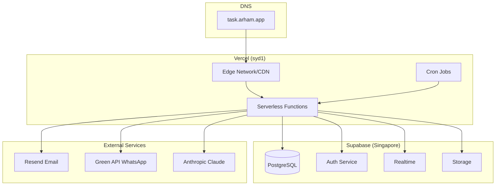

# Deployment & Infrastructure Guide

**Software/Project Name:** Delegation App
**Document ID:** DOC-DEPLOY-001
**Version:** 1.0.0
**Status:** Draft
**Author:** Documentation Engineering Team
**Creation Date:** 2026-11-02
**Last Updated:** 2026-11-02

---

## Table of Contents

1. [Infrastructure Overview](#1-infrastructure-overview)
2. [Hosting Architecture](#2-hosting-architecture)
3. [Environment Configuration](#3-environment-configuration)
4. [Development Environment](#4-development-environment)
5. [Staging Environment](#5-staging-environment)
6. [Production Environment](#6-production-environment)
7. [Build Process](#7-build-process)
8. [Deployment Procedure](#8-deployment-procedure)
9. [CI/CD Pipeline](#9-cicd-pipeline)
10. [Domain and Networking](#10-domain-and-networking)
11. [SSL/TLS Configuration](#11-ssltls-configuration)
12. [Secrets and Environment Variable Management](#12-secrets-and-environment-variable-management)
13. [Rollback Procedure](#13-rollback-procedure)
14. [Database Migration Procedure](#14-database-migration-procedure)
15. [Monitoring and Health Checks](#15-monitoring-and-health-checks)

---

## 1. Infrastructure Overview



### 1.1 Infrastructure Components

| Component | Provider | Region | Purpose |
|-----------|----------|--------|---------|
| **Hosting/CDN** | Vercel | syd1 (Sydney) | Next.js app, serverless functions, edge caching |
| **Database** | Supabase | Singapore (ap-southeast-1) | PostgreSQL, Auth, Realtime, Storage |
| **Email** | Resend | Global | Transactional emails |
| **WhatsApp** | Green API | Global | WhatsApp Business API (optional) |
| **AI** | Anthropic | Global | Claude for WhatsApp bot (optional) |
| **DNS** | External (Cloudflare/Route53) | Global | Domain management |

### 1.2 Regional Alignment

- **Vercel**: `syd1` (configured in `vercel.json`)
- **Supabase**: Singapore (ap-southeast-1) — same geographic region for low latency
- **Latency Target**: < 50ms Vercel ↔ Supabase

---

## 2. Hosting Architecture

### 2.1 Vercel Deployment Model

| Aspect | Configuration |
|--------|---------------|
| **Framework** | Next.js 15 (App Router) |
| **Build Output** | Hybrid (Static + Serverless) |
| **Runtime** | Node.js 20.x (Vercel default) |
| **Regions** | `syd1` (single region for data locality) |
| **Functions** | Serverless (API routes, Cron) |
| **Edge** | Middleware, static assets |
| **Caching** | `experimental.staleTimes`: dynamic 30s, static 60s |

### 2.2 Function Configuration

```javascript
// next.config.mjs
export default {
  reactStrictMode: true,
  outputFileTracingRoot: process.cwd(),
  experimental: {
    staleTimes: { dynamic: 30, static: 60 },
  },
  async headers() {
    return [{
      source: '/sw.js',
      headers: [
        { key: 'Cache-Control', value: 'no-cache, no-store, must-revalidate' },
        { key: 'Content-Type', value: 'application/javascript; charset=utf-8' }
      ]
    }];
  },
};
```

### 2.3 Vercel Cron Jobs

```json
// vercel.json
{
  "regions": ["syd1"],
  "crons": [
    {
      "path": "/api/checklist/generate",
      "schedule": "30 0 * * *"
    },
    {
      "path": "/api/tasks/proofs/cleanup",
      "schedule": "0 21 * * *"
    }
  ]
}
```

| Cron Job | Schedule (UTC) | Purpose |
|----------|----------------|---------|
| Checklist Generation | 00:30 daily | Generate daily checklist items |
| Proof Cleanup | 21:00 daily | Remove old proof screenshots |

---

## 3. Environment Configuration

### 3.1 Environment Variables

#### Required (All Environments)

| Variable | Description | Example |
|----------|-------------|---------|
| `NEXT_PUBLIC_SUPABASE_URL` | Supabase project URL | `https://abc123.supabase.co` |
| `NEXT_PUBLIC_SUPABASE_PUBLISHABLE_KEY` | Supabase anon/publishable key | `sb_publishable_...` |
| `NEXT_PUBLIC_CHECKLIST_TIMEZONE` | Client timezone for scheduling | `Asia/Kolkata` |

#### Server-Only (Vercel Environments)

| Variable | Description | Example |
|----------|-------------|---------|
| `SUPABASE_SERVICE_ROLE_KEY` | Service role key (bypasses RLS) | `sb_secret_...` |
| `CRON_SECRET` | Long random string for Cron auth | `openssl rand -hex 32` |
| `CHECKLIST_TIMEZONE` | Server timezone for generation | `Asia/Kolkata` |
| `RESEND_API_KEY` | Resend API key | `re_...` |
| `RESEND_FROM_EMAIL` | Verified sender email | `Delegation <no-reply@domain.com>` |
| `NEXT_PUBLIC_SITE_URL` | Deployed app origin | `https://task.arham.app` |

#### Optional (WhatsApp Bot)

| Variable | Description |
|----------|-------------|
| `GREEN_API_URL` | Green API base URL |
| `GREEN_ID_INSTANCE` | Green API instance ID |
| `GREEN_API_TOKEN` | Green API token |
| `GREEN_WEBHOOK_TOKEN` | Webhook validation token |
| `ALLOWED_CHAT_IDS` | Comma-separated chat IDs |
| `ANTHROPIC_API_KEY` | Anthropic API key |
| `WA_DRY_RUN` | Set to `true` for testing |

### 3.2 Environment-Specific Values

| Variable | Development | Preview | Production |
|----------|-------------|---------|------------|
| `NEXT_PUBLIC_SUPABASE_URL` | Local/dev project | Preview branch project | Production project |
| `NEXT_PUBLIC_SUPABASE_PUBLISHABLE_KEY` | Dev key | Preview key | Production key |
| `SUPABASE_SERVICE_ROLE_KEY` | Dev key | Preview key | Production key |
| `CRON_SECRET` | Dev value | Preview value | **Unique production value** |
| `NEXT_PUBLIC_SITE_URL` | `http://localhost:3000` | `https://delegation-app-git-<branch>.vercel.app` | `https://task.arham.app` |
| `RESEND_API_KEY` | Test key | Test key | Production key |
| `RESEND_FROM_EMAIL` | Test sender | Test sender | Verified production sender |

---

## 4. Development Environment

### 4.1 Prerequisites

| Tool | Version | Installation |
|------|---------|--------------|
| Node.js | 20.x | `nvm install 20` |
| npm | 10.x | Included with Node |
| Git | Latest | `brew install git` |
| Supabase CLI | Latest | `npm i -g supabase` (optional) |

### 4.2 Setup Steps

```bash
# 1. Clone repository
git clone https://github.com/OWNER/delegation-app.git
cd delegation-app

# 2. Install dependencies
npm install

# 3. Create local environment file
cp .env.example .env.local
# Edit .env.local with your Supabase dev project credentials

# 4. Start development server
npm run dev
# Opens http://localhost:3000
```

### 4.3 Local Supabase (Optional)

```bash
# Start local Supabase stack
supabase start

# Apply migrations
supabase db reset

# Get local credentials
supabase status
```

### 4.4 Development Workflow

1. Create feature branch: `git checkout -b feature/xyz`
2. Make changes
3. Run tests: `npm run test`
4. Run lint: `npm run lint`
5. Commit and push
6. Open PR → triggers Preview deployment

---

## 5. Staging Environment

### 5.1 Vercel Preview Deployments

- **Trigger**: Push to any branch (except `main`)
- **URL**: `https://delegation-app-git-<branch>-<owner>.vercel.app`
- **Environment Variables**: Inherited from Vercel project settings (Preview scope)
- **Database**: Separate Supabase project (recommended) or branch database

### 5.2 Preview Database Strategy

| Approach | Pros | Cons |
|----------|------|------|
| **Shared Preview DB** | Simple | Data conflicts between branches |
| **Branch-specific DB** | Isolation | More Supabase projects to manage |
| **Local DB only** | Free, fast | No real data testing |

**Recommendation**: Use shared Preview Supabase project with migration verification.

### 5.3 Preview Testing Checklist

- [ ] Login works
- [ ] Employee creation + invitation email
- [ ] Task creation and assignment
- [ ] Checklist template creation
- [ ] Manual checklist generation
- [ ] MIS report loads
- [ ] Notifications appear
- [ ] PWA install prompt

---

## 6. Production Environment

### 6.1 Vercel Production Deployment

- **Trigger**: Push to `main` branch
- **URL**: `https://task.arham.app` (custom domain)
- **Environment Variables**: Production scope in Vercel
- **Database**: Production Supabase project

### 6.2 Production Supabase Setup

1. Create production Supabase project
2. Save database password securely
3. Run migrations in order:
   ```sql
   -- In Supabase SQL Editor, run sequentially:
   -- 1. 001_initial_schema.sql
   -- 2. 002_product_features.sql
   -- 3. 003_checklist.sql
   -- 4. 004_checklist_due_time.sql
   -- 5. 005_checklist_completion_permissions.sql
   -- 6. 006_checklist_monthly_days.sql
   -- 7. 007_notifications.sql
   -- 8. 20260817045334_checklist_non_working_day_deactivation.sql
   -- 9. 20260817120000_checklist_direct_non_working_days.sql
   -- 10. 20261024061358_optimize_work_list_queries.sql
   -- 11. Additional patches as needed
   ```
4. Configure Auth:
   - Site URL: `https://task.arham.app`
   - Redirect URLs: `https://task.arham.app/update-password`
5. Copy Project URL and Publishable Key

### 6.3 First Administrator Setup

```bash
# 1. In Supabase Dashboard → Authentication → Users → Add user
#    Email/password, mark email confirmed

# 2. Copy user UUID

# 3. In Table Editor → employees → Insert row:
#    auth_user_id: <copied UUID>
#    name: "Administrator Name"
#    email: "admin@domain.com"
#    role: "super_admin"
#    active: true
#    must_change_password: false
```

### 6.4 Production Verification

- [ ] Login works on `https://task.arham.app`
- [ ] Employee creation + invitation email delivered
- [ ] Task creation and assignment
- [ ] Checklist generation (manual + verify Cron)
- [ ] MIS report loads with data
- [ ] Notifications real-time
- [ ] PWA install works
- [ ] Custom domain resolves correctly
- [ ] SSL certificate valid

---

## 7. Build Process

### 7.1 Build Command

```bash
npm run build
```

### 7.2 Build Steps

1. **TypeScript/JS Compilation**: Next.js compiles App Router pages
2. **Static Generation**: Static pages pre-rendered
3. **Serverless Function Bundling**: API routes bundled
4. **Asset Optimization**: Images, fonts, CSS optimized
5. **Output**: `.next/` directory with build artifacts

### 7.3 Build Requirements

| Requirement | Value |
|-------------|-------|
| Node.js | 20.x |
| Memory | 4GB+ (Vercel default) |
| Timeout | 5 minutes (Vercel default) |
| Dependencies | All in `package.json` |

### 7.4 Build Output Analysis

```bash
# Analyze bundle size
npx @next/bundle-analyzer
```

---

## 8. Deployment Procedure

### 8.1 Standard Deployment (Git Push)

```bash
# 1. Ensure main branch is up to date
git checkout main
git pull origin main

# 2. Merge feature branch (via PR)
#    - PR passes CI (lint, test)
#    - Code review approved

# 3. Push to main triggers production deployment
git push origin main
```

### 8.2 Manual Deployment (Vercel CLI)

```bash
# Install Vercel CLI
npm i -g vercel

# Login
vercel login

# Deploy to production
vercel --prod
```

### 8.3 Deployment Checklist

| Step | Verification |
|------|--------------|
| Pre-deploy | All tests pass (`npm run test`) |
| Pre-deploy | Lint clean (`npm run lint`) |
| Pre-deploy | Build succeeds locally (`npm run build`) |
| Deploy | Vercel build logs show no errors |
| Post-deploy | Health check: `https://task.arham.app/api/health` (if implemented) |
| Post-deploy | Login test on production URL |
| Post-deploy | Cron job next run verified in Vercel dashboard |

---

## 9. CI/CD Pipeline

### 9.1 GitHub Actions (Implicit via Vercel)

Vercel automatically creates CI/CD on GitHub integration:

| Event | Action |
|-------|--------|
| Push to any branch | Preview deployment |
| Push to `main` | Production deployment |
| Pull Request | Preview deployment + comment with URL |

### 9.2 Custom CI (Optional)

```yaml
# .github/workflows/ci.yml
name: CI
on: [push, pull_request]
jobs:
  test:
    runs-on: ubuntu-latest
    steps:
      - uses: actions/checkout@v4
      - uses: actions/setup-node@v4
        with:
          node-version: '20'
      - run: npm ci
      - run: npm run lint
      - run: npm run test
      - run: npm run build
```

---

## 10. Domain and Networking

### 10.1 Custom Domain Setup

1. **In Vercel Dashboard**: Project → Settings → Domains → Add `task.arham.app`
2. **Vercel Provides**: DNS records (A + CNAME or CNAME only)
3. **At DNS Provider**: Add records exactly as shown
4. **Verification**: Vercel validates and provisions SSL
5. **Switch**: Update DNS; keep old records until new deployment verified

### 10.2 DNS Records (Example)

| Type | Name | Value | TTL |
|------|------|-------|-----|
| A | @ | 76.76.21.21 | 300 |
| CNAME | www | cname.vercel-dns.com | 300 |

### 10.3 Network Security

| Boundary | Protection |
|----------|------------|
| Internet → Vercel | Vercel Edge (DDoS, WAF, rate limiting) |
| Vercel → Supabase | Supabase IP allowlist / VPC peering (if configured) |
| Vercel → External APIs | HTTPS + API keys (server-only) |

---

## 11. SSL/TLS Configuration

### 11.1 Certificate Management

| Aspect | Value |
|--------|-------|
| **Provider** | Vercel (automatic via Let's Encrypt) |
| **Renewal** | Automatic (30 days before expiry) |
| **Protocol** | TLS 1.2, TLS 1.3 |
| **HSTS** | Enabled by Vercel (1 year) |
| **Certificate Transparency** | Yes |

### 11.2 Security Headers

| Header | Value |
|--------|-------|
| `Strict-Transport-Security` | `max-age=31536000; includeSubDomains` |
| `X-Content-Type-Options` | `nosniff` |
| `X-Frame-Options` | `SAMEORIGIN` |
| `Referrer-Policy` | `strict-origin-when-cross-origin` |
| `Content-Security-Policy` | Next.js default (`script-src 'self'`) |

---

## 12. Secrets and Environment Variable Management

### 12.1 Vercel Environment Variables

**In Vercel Dashboard**: Project → Settings → Environment Variables

| Variable | Environments | Notes |
|----------|--------------|-------|
| `NEXT_PUBLIC_SUPABASE_URL` | Production, Preview, Development | |
| `NEXT_PUBLIC_SUPABASE_PUBLISHABLE_KEY` | Production, Preview, Development | |
| `NEXT_PUBLIC_CHECKLIST_TIMEZONE` | Production, Preview, Development | |
| `SUPABASE_SERVICE_ROLE_KEY` | Production, Preview, Development | **Server-only** |
| `CRON_SECRET` | Production, Preview, Development | **Server-only**; unique per env |
| `CHECKLIST_TIMEZONE` | Production, Preview, Development | **Server-only** |
| `RESEND_API_KEY` | Production, Preview, Development | **Server-only** |
| `RESEND_FROM_EMAIL` | Production, Preview, Development | **Server-only** |
| `NEXT_PUBLIC_SITE_URL` | Production, Preview, Development | |
| WhatsApp vars | Production, Preview | **Server-only**; optional |

### 12.2 Secret Generation

```bash
# CRON_SECRET (32 bytes hex = 64 chars)
openssl rand -hex 32

# Or using Node
node -e "console.log(require('crypto').randomBytes(32).toString('hex'))"
```

### 12.3 Local Development

```bash
# .env.local (gitignored)
NEXT_PUBLIC_SUPABASE_URL=https://your-dev-project.supabase.co
NEXT_PUBLIC_SUPABASE_PUBLISHABLE_KEY=sb_publishable_...
# Server-only vars not needed locally unless testing server features
```

### 12.4 Rotation Procedure

1. Generate new secret
2. Update in Vercel Dashboard (all environments)
3. Redeploy (or wait for next deployment)
4. Verify functionality
5. Revoke old secret in provider (Supabase, Resend, etc.)

---

## 13. Rollback Procedure

### 13.1 Vercel Rollback

1. **Vercel Dashboard** → Deployments
2. Find previous successful deployment
3. Click **...** → **Promote to Production**
4. Or: `vercel rollback <deployment-url> --prod`

### 13.2 Git Rollback (Code Only)

```bash
# Revert commit
git revert <commit-hash>
git push origin main

# Or reset (if no shared history)
git reset --hard <good-commit>
git push --force-with-lease origin main
```

### 13.3 Database Rollback

| Scenario | Procedure |
|----------|-----------|
| Migration failed | Supabase PITR to pre-migration timestamp |
| Bad data from code | Supabase PITR; or manual SQL fix |
| Schema drift | Compare with migration files; apply missing |

**Note**: Database rollbacks are **not** automatic with code rollbacks. Migrations are forward-only.

---

## 14. Database Migration Procedure

### 14.1 Migration Files

Location: `supabase/migrations/` — numbered sequentially

### 14.2 Applying Migrations

```bash
# Option 1: Supabase Dashboard (Recommended)
# 1. Go to SQL Editor
# 2. Copy migration file content
# 3. Run

# Option 2: Supabase CLI (if linked)
supabase db push

# Option 3: psql (direct)
psql "postgresql://postgres:<password>@<host>:5432/postgres" -f migration.sql
```

### 14.3 Migration Order

Migrations must be applied in sequence:

1. `001_initial_schema.sql`
2. `002_product_features.sql`
3. `003_checklist.sql`
4. `004_checklist_due_time.sql`
5. `005_checklist_completion_permissions.sql`
6. `006_checklist_monthly_days.sql`
7. `007_notifications.sql`
8. `20260817045334_checklist_non_working_day_deactivation.sql`
9. `20260817120000_checklist_direct_non_working_days.sql`
10. `20261024061358_optimize_work_list_queries.sql`
11. Additional patches in timestamp order

### 14.4 Migration Safety

- **Idempotent**: Use `IF NOT EXISTS`, `DROP IF EXISTS`
- **Backward Compatible**: Add columns with defaults; avoid breaking changes
- **Test First**: Apply to staging/preview before production
- **Verify**: Run test suite after migration

### 14.5 Rollback Strategy

- No down migrations maintained
- Use Supabase PITR (Point-in-Time Recovery) for disaster recovery
- 7-day retention on Supabase Pro

---

## 15. Monitoring and Health Checks

### 15.1 Vercel Monitoring

| Metric | Source | Alert Threshold |
|--------|--------|-----------------|
| Function Duration | Vercel Analytics | > 10s (p95) |
| Function Errors | Vercel Analytics | > 1% |
| Build Failures | Vercel Dashboard | Any |
| Cron Failures | Vercel Cron Logs | Any |

### 15.2 Supabase Monitoring

| Metric | Source | Alert Threshold |
|--------|--------|-----------------|
| Database CPU | Supabase Dashboard | > 80% sustained |
| Database Connections | Supabase Dashboard | > 80% of limit |
| Disk Usage | Supabase Dashboard | > 80% |
| Auth Errors | Supabase Logs | Spike |
| Realtime Disconnects | Supabase Logs | Spike |

### 15.3 Application Health Checks

```javascript
// Optional: Add health check endpoint
// app/api/health/route.js
export async function GET() {
  try {
    const supabase = createSupabaseAdminClient();
    const { error } = await supabase.from('employees').select('id').limit(1);
    if (error) throw error;
    return Response.json({ status: 'healthy', timestamp: new Date().toISOString() });
  } catch (e) {
    return Response.json({ status: 'unhealthy', error: e.message }, { status: 503 });
  }
}
```

### 15.4 Logging

| Log Type | Location | Retention |
|----------|----------|-----------|
| Vercel Function Logs | Vercel Dashboard | 30 days |
| Supabase Logs | Supabase Dashboard | 7 days |
| Browser Console | Client-side | Session |
| Custom App Logs | `console.log/error` in code | Vercel logs |

---

## Document Control

| Version | Date | Author | Description |
|---------|------|--------|-------------|
| 1.0.0 | 2026-11-02 | Documentation Engineering Team | Initial version |

---

*End of Deployment & Infrastructure Guide*